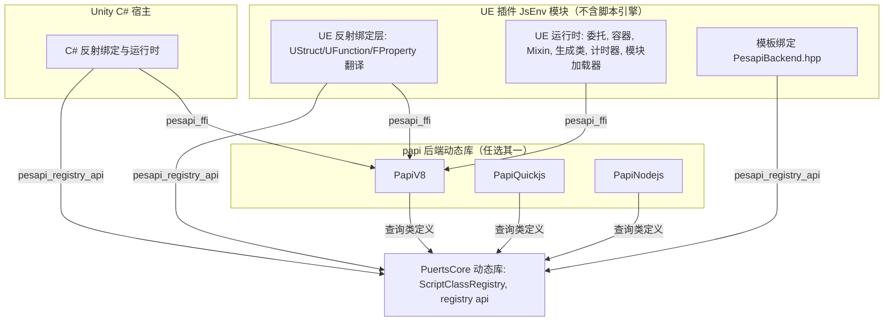
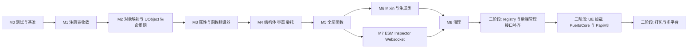

# Unreal 与 Unity 基于 papi 统一架构设计

状态：草案，待评审
范围：unreal/Puerts/Source/JsEnv、unity/native/puerts、unity/native/papi-*

## 1. 背景与目标

Unity 版 PuerTS 3.x 已经完成 papi 化：脚本引擎实现被封装为独立动态库（PapiV8、PapiQuickjs、PapiNodejs、PapiLua、PapiPython），宿主（C#）只通过 `pesapi_ffi` 函数指针表操作脚本值，通过 `pesapi_registry_api` 注册类型，类型注册表由独立的 PuertsCore 库承载。

Unreal 版目前仍是“V8 API 直接编程”的架构：JsEnv 模块把 V8 静态库链接进 UE 模块，反射绑定、容器、委托、Mixin、模块加载、调试器等全部直接调用 `v8::` API。前两次提交只完成了 pesapi 接口层（v11）与静态绑定的升级，UE 主体并未依赖 papi。

目标：

1. 第一阶段（papi 化）：UE 侧的绑定与运行时逻辑改为基于 papi 实现，papi 暂时缺失的能力允许继续调用 V8 API，但必须集中、可统计、可替换。
2. 第二阶段（统一二进制）：UE 与 Unity 加载同一份 papi 后端动态库（以及同一份 PuertsCore），UE 模块本身不再链接、不再 include 任何脚本引擎。

非目标：本文不涉及 TS 声明生成器、蓝图生成类的功能变化，不改变面向用户的 JS API。

## 2. 现状对比

| 维度 | Unity 3.x | Unreal 当前 |
| --- | --- | --- |
| 引擎接入 | PapiV8 等独立动态库，宿主只见 C ABI | V8 静态库链接进 JsEnv 模块 |
| 值操作 | `pesapi_ffi` 函数表 | 直接 `v8::Local<v8::Value>` |
| 类型注册 | PuertsCore 的 `ScriptClassRegistry`，可多实例，`set_registry` 绑定到 env | `JSClassRegister` 全局单例 |
| 宿主反射类型 | C# 类型经 registry 懒注册（on_class_not_found 加懒加载拦截器） | `FStructWrapper` 为每个 UStruct 直接生成 `v8::FunctionTemplate` |
| 对象映射 | papi-v8 内的 `CppObjectMapper`，ObjectCacheNode 缓存加生命周期回调 | `FJsEnvImpl::ObjectMap`、`FCppObjectMapper` 两套 |
| ESM、调试器 | 在 papi-v8 内部（BackendEnv、V8InspectorImpl） | 在 JsEnvImpl 内部 |
| 多后端 | 每个后端一个 papi 动态库 | 宏切换 V8 / Node / QuickJS（QuickJS 通过 v8 兼容层） |
| 已共享代码 | papi-v8 的 CMake 已直接引用 `unreal/.../V8InspectorImpl.cpp` 等文件 | 同左 |

UE 侧对 V8 的依赖规模（`v8::` 出现次数，按文件）：

| 文件 | 次数 | 行数 | 说明 |
| --- | --- | --- | --- |
| JsEnvImpl.cpp / .h | 906 / 307 | 4909 / 779 | 运行时主体：对象映射、全局函数、模块、Mixin、计时器、委托 |
| PropertyTranslator.cpp / .h | 374 / 71 | 1425 / 202 | FProperty 与 JS 值互转，热路径 |
| V8Backend.hpp | 326 | 677 | 模板绑定的 V8 后端 |
| ContainerWrapper.cpp / .h | 225 / 99 | 858 / 402 | TArray / TSet / TMap / FixedArray |
| StructWrapper.cpp / .h | 190 / 34 | 739 / 141 | UStruct 到 JS 类 |
| FFIBinding.cpp | 175 | 609 | libffi 绑定（可选功能） |
| CppObjectMapper.cpp / .h | 159 / 46 | 501 / 107 | 模板绑定对象映射 |
| UEDataBinding.hpp | 148 | 577 | UE 基础类型的模板绑定特化 |
| WebSocketImpl.cpp | 116 | 486 | 可选功能 |
| 其余约 30 个文件 | 约 700 | | 委托、函数翻译、DataTransfer、Inspector、Wasm3 等 |

合计约 4600 处，其中真正需要重写的业务逻辑集中在 JsEnvImpl、PropertyTranslator、FunctionTranslator、StructWrapper、ContainerWrapper、DelegateWrapper 六组文件。

## 3. 可行性结论

结论：两步都可行。第一阶段工作量大但风险可控；第二阶段的主要难点不在代码，而在二进制边界、打包与平台工具链。

支撑依据：

- 能力层面：Unity 用同一套 papi 承载了 C# 全量反射绑定（含继承、重载、属性、静态成员、委托、GC 宿主的生命周期跟踪），UE 的 UClass / UStruct / UFunction / FProperty 绑定在模型上与之同构，type_id 直接用 `UStruct*` 即可。
- 迁移层面：在 UE 自带的 V8 papi 实现里，`pesapi_value` 与 `v8::Local<v8::Value>`、`pesapi_env` 与 `v8::Local<v8::Context>` 只是 reinterpret 关系，可以逐函数、逐文件迁移，每一步都能编译、能运行，不需要一次性切换。
- 实现层面：papi-v8 的 `CppObjectMapper`、`BackendEnv`（ESM）、Inspector 已经在 Unity 侧跑通，UE 可直接复用，减少重复实现。
- 收益层面：第二阶段完成后，UE 自动获得 papi-quickjs、papi-nodejs 后端（替代现在的 QuickJS v8 兼容层和 Node 宏分支），V8 版本升级也与 UE 模块解耦。

主要风险（详见第 8 节）：热路径性能回退、JS 可见行为差异（原型链、属性枚举、对象身份）、UObject 显式销毁与地址复用、UE 静态初始化期注册、各平台打包。

## 4. 目标架构



二进制边界只允许三类 C ABI：

1. `pesapi_ffi`：值、作用域、引用、调用、对象映射。
2. `pesapi_registry_api`：类型注册与查询（含第二阶段需要补充的枚举接口）。
3. 后端管理接口：创建 / 销毁 env、GC、调试器、tick、终止执行等（第二阶段统一为一个函数表，见 6.3）。

## 5. 第一阶段：papi 化改造

### 5.1 原则

- 增量迁移：每个合入点都必须能通过 BuildPlugin 并通过回归测试，不做长期分叉分支。
- 行为不变：JS 可见行为（原型链、`instanceof`、属性可枚举性、对象身份、异常文本）以现状为准，差异必须在测试中显式记录。
- V8 逃生口集中化：暂时缺失的能力通过一个桥接头文件 `PapiV8Bridge.h` 访问 V8，禁止新代码在别处直接 include `v8.h`。桥接点的数量就是第二阶段的剩余工作量指标。
- 先换地基，再换上层：先统一 env 与注册表、对象映射，再迁移翻译器与运行时。

### 5.2 桥接层

```cpp
// PapiV8Bridge.h，仅第一阶段存在
namespace puerts::papi_bridge
{
inline v8::Local<v8::Value> ToV8(pesapi_value v);
inline pesapi_value ToPapi(v8::Local<v8::Value> v);
inline v8::Local<v8::Context> ToV8(pesapi_env env);
inline pesapi_env ToPapi(v8::Local<v8::Context> ctx);
inline v8::Isolate* IsolateOf(pesapi_env env);
}
```

- 这些函数只在 UE 自带的 V8 papi 实现下成立，依赖 v8impl 里的 reinterpret 约定，第二阶段整体删除。
- CI 增加一个检查：统计 `papi_bridge::` 和 `#include "v8.h"` 的出现位置，只允许减少不允许增加（白名单文件除外）。

### 5.3 环境与注册表

1. FJsEnvImpl 持有 `pesapi_env_ref` 与 `pesapi_ffi*`，所有新代码通过它们操作，旧代码通过桥接层取回 Isolate / Context。
2. 注册表向 Unity 的 `ScriptClassRegistry` 收敛：
   - 先让 `JSClassDefinition` 的字段布局与 `ScriptClassDefinition` 对齐（UETypeName、OnEnter / OnExit、Data 等字段 Unity 版已具备）。
   - 再把 `JSClassRegister` 的存储换成 `ScriptClassRegistry` 实例，对外保留 `RegisterJSClass` 等旧函数作为薄包装，保证已有用户代码与 DeclarationGenerator 不受影响。
   - UE 仍只用一个全局 registry，但通过 `set_registry` 绑定到每个 env，而不是在实现里写死。
3. UE 的对象映射向 papi-v8 的 `CppObjectMapper`（Unity 版，含懒加载拦截器）对齐，UE 的 `FCppObjectMapper` 退役。第一阶段在 UE 目录内维护一份对齐后的实现，不引用也不修改 `unity/` 下的源码（见 5.9）。

### 5.4 UE 反射绑定改造（核心）

现状是 `FStructWrapper` 为每个 UStruct 直接构造 `v8::FunctionTemplate`。改造后统一走 registry：

| UE 概念 | papi 映射 |
| --- | --- |
| UClass / UScriptStruct | `define_class(type_id = UStruct*, super_type_id = SuperStruct)`，在 `on_class_not_found` 中按需注册 |
| UFunction | `set_method_info`，callback 为通用 thunk，data 为 `FFunctionTranslator*` |
| 静态 UFunction | `set_method_info(is_static = 1)` |
| FProperty | `set_property_info`，getter / setter 为通用 thunk，data 为 `FPropertyTranslator*` |
| 构造 | constructor 回调创建 UObject 或分配 UStruct 内存 |
| 析构 | UStruct 由 finalize 释放；UObject 不释放，见 5.6 |
| 扩展方法（UEExtension） | 注册时合并进 method 列表 |
| TArray / TSet / TMap | 每类容器一个固定 type_id，native 对象为 `{容器指针, 元素 FProperty*, 是否持有}` 的包装 |
| 委托 | JS 函数存为 `pesapi_value_ref`，执行时 `call_function` |

翻译器接口改造：

```cpp
// 改造前
virtual v8::Local<v8::Value> UEToJs(v8::Isolate*, v8::Local<v8::Context>, const void* ValuePtr, bool PassByPointer) const = 0;
virtual bool JsToUE(v8::Isolate*, v8::Local<v8::Context>, const v8::Local<v8::Value>& Value, void* ValuePtr, bool DeepCopy) const = 0;

// 改造后
virtual pesapi_value UEToJs(pesapi_ffi* Apis, pesapi_env Env, const void* ValuePtr, bool PassByPointer) const = 0;
virtual bool JsToUE(pesapi_ffi* Apis, pesapi_env Env, pesapi_value Value, void* ValuePtr, bool DeepCopy) const = 0;
```

性能相关约束：

- 每次调用只 `get_env` 一次，Apis 与 Env 作为参数向下传递，避免重复取。
- 字符串优先 `get_value_string_utf16` 直接转 FString，避免 UTF8 中转。
- 基础类型属性（int / float / bool）在注册期选择专用 thunk，减少虚调用。
- 保留现有 `PUERTS_FORCE_CPP_UFUNCTION` 等开关的语义。

### 5.5 模块迁移清单

| 批次 | 内容 | 规模 | 依赖 |
| --- | --- | --- | --- |
| M0 | 回归测试与性能基准（见 5.8），桥接层，CI 计数检查 | S | 无 |
| M1 | 注册表收敛到 ScriptClassRegistry，模板绑定默认改用 PesapiBackend.hpp | M | M0 |
| M2 | 对象映射统一到 papi-v8 CppObjectMapper，UObject 生命周期方案落地 | M | M1 |
| M3 | PropertyTranslator、FunctionTranslator 改为 papi 签名 | L | M2 |
| M4 | StructWrapper 改为 registry 注册，ContainerWrapper、DelegateWrapper、Soft / Weak 包装 | L | M3 |
| M5 | JsEnvImpl 全局函数（puerts.*、UE 代理、计时器、日志、加载器回调）改为 `create_function` | M | M4 |
| M6 | Mixin、TS 生成类、蓝图调用 JS（InvokeJsMethod 等） | M | M5 |
| M7 | ESM、Inspector、热重载切换到 papi-v8 的 BackendEnv / 导出接口；Websocket 改用 wsppaddon | M | M5 |
| M8 | 清理：V8Backend.hpp、V8Object.hpp、V8FastCall.hpp 标记废弃；FFI、Wasm3 改为基于 papi 的可选 addon 或保留 V8 专属 | S | M6 |

第一阶段完成判据：除 PesapiV8Impl、桥接层与白名单中的 V8 专属可选功能外，JsEnv 内不再 include `v8.h`。

M3 落地情况：

- `FPropertyTranslator` 的虚函数（UEToJs、JsToUE、JsToUEFast、UEOutToJs、JsToUEOut）已改为 papi 签名 `(pesapi_ffi* Apis, pesapi_env Env, ...)`。旧的 V8 签名保留为非虚的内联适配器，内部以 `v8impl::g_pesapi_ffi` 加 papi_bridge 转调，尚未迁移的调用方不用改，且没有额外开销。
- 直接用 papi 实现的类型：整数、浮点、布尔、枚举、FString、FName、FText（非 `PUERTS_FTEXT_AS_OBJECT` 模式）、FFieldPath、out 参数包装（`{0: value}`）、DoNothing。
- 依赖 IObjectMapper / DataTransfer 的类型（UObject、Soft、Interface、Struct、ArrayBuffer、JsObject、容器、定长数组、委托）暂时保留 V8 实现（`UEToJsV8` / `JsToUEV8`），papi 入口通过桥接转发，M4 随这些包装一起迁移。
- 抛异常仍走桥接调用 `FV8Utils::ThrowException`：`pesapi_throw_by_string` 需要 callback info，翻译器内部拿不到。
- 行为差异：
  - 数值转换失败（例如对象的 `valueOf` 抛异常）时，旧实现 `ToChecked` 会直接崩溃，现在按 pesapi 语义返回 0。
  - int64 / uint64 仍保持“不是 BigInt 就不修改原值”（先用 `is_int64` 判断）。
  - 字符串转换对非 string 值调用 `ToString`，无法转换的值（如 Symbol）得到空串，与旧 `ToFString` 一致；但 FName 旧实现走 `Utf8Value`，现在与 FString 一样。由于 pesapi 先取长度再写入，非 string 值的 `toString` 会被调用两次。
- 基准：property.*、ufunction.* 指标与 M1 结果相比正负交错，在噪声范围内（同轮未改动的 cpp.*、delegate、mixin 指标波动 10% 到 30%）。
- `FFunctionTranslator` / `FExtensionMethodTranslator`：调用路径（Call、FastCall、SlowCall、CallJs、CallExtension）已改为 papi 签名，参数读取用 `get_arg` / `is_undefined`，返回值用 `add_return`，异常用 `throw_by_string`，JS 回调用 `call_function`。V8 签名保留为内联适配器。
  - 调用目标 UObject 由 `get_native_holder_ptr` 取句柄后经 `DataTransfer::GetUObjectOfNativePtr` 解包，与 `GetUObjectOfWrapper` 行为一致。
  - 函数模板（`ToFunctionTemplate`）仍是 V8，M4 改为 registry 注册时一起迁移。
  - extension 方法的 receiver 值通过桥接 `HolderOf` 获取，因为 papi 目前只有 `get_native_holder_ptr`，没有取 holder 值的接口。
  - papi_bridge 增加了 `ToPapi(v8::Local<T>)` 模板重载：`v8::Local` 的转换构造函数不受约束，`Local<Object>` 等传给 `ToPapi` 时会在 value 与 env 两个重载间产生歧义。
  - 基准：ufunction.* 正负交错；delegate.cpp_to_js、mixin.cpp_to_js 两轮分别 +28%/+8%、+20%/+6%，落在 M2-1、M3-1 的历史区间内，判定为噪声。

M4 落地情况（分批进行）：

- M4-1：属性访问器与 UFunction 的回调改为 pesapi 风格（`void(pesapi_ffi*, pesapi_callback_info)`），翻译器通过 `get_userdata` 取得。`FPropertyTranslator` 持有 `JSPropertyInfo AccessorInfo`，`FFunctionTranslator` 持有 `JSFunctionInfo CallbackInfo`，v8 模板统一由 `ClassThunks` 根据这两个条目生成，与 registry 中静态绑定类的处理方式一致，为后续改成 registry 注册做准备。
  - `AccessorInfo` 在构造时填充：`CreateOn` 会在原地址 placement new 重建翻译器，复用的模板仍指向同一地址，重建后依然有效。
  - 委托属性的 getter 仍通过桥接调用 `IObjectMapper::FindOrAddDelegate`（委托包装在 M4-4 迁移）；`LinkOuter` 仍走桥接（papi 没有取 holder 值的接口）。
  - 基准：property.get_int 两轮均约 +10%（53ns 到 59ns），来自每次访问额外的几次 ffi 间接调用（get_userdata、get_native_holder_ptr、add_return）；其余 property.*、ufunction.* 在噪声范围内。M4 完成后统一评估是否为基础类型属性提供专用 thunk（见 5.4 性能约束）。
- M4-2：`FStructWrapper` 的静态函数 `StaticClass`/`StaticStruct`、`Find`、`Load` 改为 pesapi 回调，条目为 `StaticClassInfo`、`FindInfo`、`LoadInfo`，在构造时填充，模板由 `ClassThunks::MethodTemplate` 生成。新增 `Private/PapiUtils.h`，集中放置 papi 侧通用 helper（FString 转换、`GetUObject` 解包、`FindOrAddUObject`），属性翻译器中的字符串 helper 也改为转调它。
  - `FindOrAddUObject` 暂时通过桥接调用 `IObjectMapper::FindOrAdd`，M4-5 对象映射 papi 化后去掉。
  - 构造函数 `New` 仍是 v8 实现（pesapi 没有 IsConstructCall），留到 M4-6 改由 registry 构建模板时处理。
  - 基准：这批改动不在热点路径上，两轮数据都在噪声范围内（property.get_string 一轮为 104ns，复测为 76ns）。
- M4-3：容器包装（`TArray`、`TSet`、`TMap`、定长数组）的方法改为 pesapi 回调。每个包装用一张静态的 `JSFunctionInfo` 表，经 `ClassThunks::MethodTemplate` 生成原型方法。槽位沿用原布局：field 0 是容器指针，用 `get_native_holder_ptr` 读取；field 1 是元素翻译器（Map 为 key 翻译器），占用 papi 的 type id 槽，用 `get_native_holder_typeid` 读取。
  - Map 的 value 翻译器在 field 2，papi 只暴露两个槽，暂时通过桥接读取。M4-5 对象映射 papi 化时，改为让 field 1 指向一个 key/value 翻译器对。
  - 构造函数 `New` 和弱回调 `OnGarbageCollected*` 仍是 v8 实现，前者在 M4-6 处理，后者在 M4-5 处理。`LinkOuter` 仍走桥接。
  - 参数个数错误、索引越界等报错文本与原实现一致。`TSet.IsValidIndex` 原来返回数字，现在仍返回数字。
  - 基准：两轮测试中 array.get、map.get 与 M4-2 持平，array.num 多 1 到 2ns，处于噪声范围内。
- M4-4：委托包装（单播 `Bind`/`IsBound`/`Unbind`/`Execute`，多播 `Add`/`Remove`/`Clear`/`Broadcast`）以及 `TSoftObjectPtr`/`TSoftClassPtr`、`TWeakObjectPtr` 包装的方法改为 pesapi 回调，同样用静态 `JSFunctionInfo` 表生成原型方法。参数检查改用 `is_function`、`is_object`、`is_string`，UObject 参数经 `PapiUtils::GetUObject` 解包并检查是否已释放。
  - `IObjectMapper` 的委托接口（`AddToDelegate`、`RemoveFromDelegate`、`ClearDelegate`、`ExecuteDelegate`）参数仍是 v8 类型，暂时通过桥接转换；JS 函数参数也经桥接取 `v8::Function`。M4-5 对象映射 papi 化时一并改掉，届时委托属性 getter 也去掉桥接。
  - Soft 包装的 MetaClass 在 field 2，与 Map 的 value 翻译器一样暂时通过桥接读取。
  - 构造函数 `New` 仍是 v8 实现，留到 M4-6。
  - 基准：这批改动不在热点路径上。delegate.cpp_to_js 走的是 C++ 调 JS 的代理路径，本批未改动，194ns 到 209ns 视为噪声；其余项与 M4-3 持平。
- M4-5：翻译器与包装对 `IObjectMapper` 的访问统一收口到 `PapiUtils`（`FindOrAddUObject`、`FindOrAddStruct`、`FindOrAddContainer`、`CreateArray`、`AddSoftObjectPtr`、`FindOrAddDelegate`、`NewDelegate`、委托的增删清空与执行、`Merge`、`ThrowException`），这些 helper 是插件内对象映射桥接的唯一位置。`PUERTS_PAPI_FORWARD_*` 宏及 `UEToJsV8` / `JsToUEV8` 全部删除，UObject、Soft、Interface、Struct、ArrayBuffer、容器、定长数组、委托的翻译器改为直接用 papi 实现；委托属性 getter 和委托包装也不再直接桥接。
  - 取 native 指针统一用 `get_native_object_ptr`（与 `FV8Utils::GetPointer` 语义一致）；ArrayBuffer 用 `is_binary`、`get_value_binary`、`create_binary` / `create_binary_by_value`；`PUERTS_FTEXT_AS_OBJECT` 模式改用 `native_object_to_value`。
  - 仍保留的桥接：`FJsObject`（本身持有 v8 句柄，M8 处理）、FName 区分纯 ArrayBuffer 与 view（papi 不区分）、`LinkOuter`、Map 与 Soft 的 field 2。
  - `IObjectMapper` 接口本身仍是 v8 签名，随 M5 的 `FJsEnvImpl` 一起改为 papi，届时只需改 `PapiUtils`。
  - 范围调整：原计划放在 M4-5 的容器弱回调迁移和“Map 的 field 1 指向 key/value 翻译器对”移到 M4-6。pesapi 的 `set_ref_weak` 不带回调，弱回调只能通过 registry 类的 finalize 表达；而容器改由 registry 注册后，field 1 是固定的类 type id，翻译器需要放进 native 包装对象（见 5.4 中 `{容器指针, 元素 FProperty*, 是否持有}`），两项都依赖 M4-6。
  - 基准：两轮测试中 property.get_struct 为 79ns / 64ns，array.get 为 72ns / 59ns，ufunction.return_struct 为 627ns / 829ns，正负交错，判定为噪声；其余项与 M4-4 持平。
- M4-6（延后到 M6 之后）：UClass / UScriptStruct 的模板收进 registry。内容包括：在已有的 `on_class_not_found` 回调中按 UStruct 生成类定义；构造函数改为 papi（需要 `get_this`，见 5.7）；命名属性拦截、类名、热重载重新注册通过 UE 专用的 `CppObjectMapper` 钩子实现；UObject、Struct、容器的对象缓存从 `FJsEnvImpl` 迁到 `CppObjectMapper`，弱回调改用 finalize；容器的翻译器放进 native 包装对象。
  - 延后原因：这些改动依赖 `FJsEnvImpl` 的对象映射，等 M5、M6 把 `FJsEnvImpl` 的大部分改为 papi 后再做，改动面更小。M5 不依赖 M4-6。
  - `on_class_not_found` 的回调签名是 `int (*)(const void* type_id)`，不带 userdata，多个 env 共用一个 registry 时需要另行取得 env 上下文，届时再决定是否增加带 userdata 的变体。

M5 落地情况（分批进行）：

- M5-1：新增 `PapiMethodBindingHelper`（把成员函数绑定为 papi 函数，`this` 作为 userdata，经 `create_function` 加 `set_property` 挂到对象上）和 `PapiBindFunction`（绑定静态函数），以及与 `CHECK_V8_ARGS` 文案一致的 `PAPI_CHECK_ARGS`。首批迁移无状态的全局函数：`__tgjsLog`、`dumpStatisticsLog`、`isQuickJS`、`__tgjsFNameToArrayBuffer`、`puerts.getFNameString`、`puerts.toCString`、`puerts.toCPtrArray`。
  - 仍走桥接的部分：`__tgjsFNameToArrayBuffer` 用 `FV8Utils::ToFName` 区分 FName 原始缓冲和字符串；`dumpStatisticsLog` 读 v8 堆统计，属于 v8 专属能力，留在桥接层。
  - `toCString`、`toCPtrArray` 先在临时缓冲区里组装结果，再用 `create_binary_by_value` 拷贝出去，比原来多一次拷贝。这两个函数不在热点路径上。
- M5-2a：新增计时器的功能测试 `tests/timers.js`（注册、错误参数、触发、清除、额外参数、回调的 this），先固定现有行为作为基线。测试 runner 在每个 step 前 tick 一次 core ticker，计时器才能在测试中触发。
- M5-2b：`setTimeout`、`clearTimeout`、`setInterval`、`clearInterval` 改为 papi 实现。回调用 `pesapi_value_ref` 持有，触发时经 `get_ref_associated_env` 加 `open_scope_placement` 建立作用域，`call_function` 调用，异常用 `has_caught` 和 `get_exception_as_string` 取出并记日志。析构时在 `CppObjectMapper.UnInitialize` 之前释放这些 ref。
- M5-2c：`IObjectMapper` 改为 papi 签名（`pesapi_env`、`pesapi_value`、`pesapi_callback_info`），`PapiUtils` 的 helper 直接调用它，不再做 v8 转换。`FJsEnvImpl` 原来的 v8 版本方法去掉 virtual，作为内部实现保留，papi 版本的 override 在桥接层转调它们，后续逐个改成真正的 papi 实现。`ICppObjectMapper` 暂时保持 v8 签名，等 M6 处理。
- M5-2d：先补测试 `tests/objects.js`（`UE.NewObject`、`UE.NewStruct`、`puerts.merge`、`UE.MakeWeakObjectPtr`、`puerts.setJsTakeRef`），再把 `__tgjsMergeObject`、`__tgjsNewObject`、`__tgjsNewStruct`、`__tgjsSetJsTakeRef` 改为 papi 实现。`merge` 用 `get_native_object_typeid` 区分 struct（type id 即 UScriptStruct）和 UObject。
- M5-2e：`__tgjsUEClassToJSClass`（`blueprint.tojs`）和 `__tgjsNewContainer`（`UE.NewArray/NewSet/NewMap`）改为 papi 实现，测试先在 `tests/containers.js` 补齐。`UETypeToJsClass` 仍基于 v8 模板，经桥接调用，等 M4-6 收进 registry。补测试时发现 `UE.NewSet(-1)` 越界读 `BuiltinProperty[-1]` 导致编辑器挂死，已单独修复（下界检查）。
  - 行为变化：`setJsTakeRef` 传入非 UObject 时原来会空指针崩溃，现在抛出 "passing a invalid object"。
  - `MakeWeakObjectPtr` 依赖 v8 FunctionTemplate 和按 internal field 的弱回调，等 weak ptr wrapper 改为 registry 注册的类时一并迁移。

### 5.6 UObject 生命周期

UE 与 C# 的关键差异：UObject 可被显式销毁（Destroy、关卡卸载），且销毁后地址会被复用。如果直接把 `UObject*` 作为 papi 的 native 指针，papi-v8 的对象缓存（按指针加 type_id 查找）会在地址复用时返回过期的 JS 对象。

方案 A（推荐，无需新增 API）：句柄化，与 C# 的做法一致。

- native 指针不是 `UObject*`，而是 UE 侧分配的 `FUObjectHandle { TWeakObjectPtr<UObject> Obj; UClass* Class; }`，UE 侧维护 `UObject* -> FUObjectHandle*` 的映射。
- `trace_native_object_lifecycle` 的 on_enter 在 JS 包装对象创建时把 UObject 加入 GC 引用集合（对应 `PUERTS_KEEP_UOBJECT_REFERENCE`），on_exit 在 JS 对象被回收时移除并释放句柄。
- UObject 被销毁时只需把映射里的条目删除、句柄内的弱指针自然失效；JS 侧再访问会得到“对象已失效”的错误。句柄的地址在 JS 对象存活期间不会被复用，所以缓存不会命中过期对象。
- 代价是每次访问多一次解引用和弱指针校验，需要基准测试确认。

方案 B：新增 `pesapi_unbind_native_object(env, type_id, ptr)`，在 UObject 销毁时从缓存中摘除并清空 JS 对象内的指针。改动小、开销低，但需要 papi 增加 API，且 Unity 侧也要实现。

已决策：采用方案 A。方案 B 仅作为基准测试显示句柄开销不可接受时的备选。

M2 落地情况：

- 对象映射：UE 版 `FCppObjectMapper` 已与 Unity 版基本对齐（含 OnEnter / OnExit），差异只剩依赖 V8 >= 13 的 `PUERTS_LAZYLOAD`，暂不移植。M2 的主体是 UObject 句柄。
- 句柄定义见 `JsEnv/Public/UObjectHandle.h`：`FUObjectHandle { Magic; UObject* Object; FWeakObjectPtr WeakObject; UClass* Class; }`。`Object` 是原始指针，只作为映射的身份键，UObject 销毁后置空；`Magic` 用于拒绝把 struct、容器等非 UObject 包装传给 UObject 参数。
- UObject 包装的 internal field 0 存句柄（`FJsEnvImpl::FUObjectBinding`，在句柄上附带 JS 对象的 persistent），field 1 仍为 nullptr。`ObjectMap` 改为 `UObject* -> FUObjectBinding*`。
- UObject 先被销毁：条目移出 `ObjectMap`，句柄分离（Object 置空、弱指针 Reset），JS 对象改为以句柄为参数的弱引用并放入 `ReleasedObjectBindings`，待 JS 对象回收时释放句柄。JS 对象先被回收：直接释放句柄。
- 所有读取点统一走 `DataTransfer::GetUObjectOfWrapper` / `FV8Utils::GetUObject`，pending kill 语义不变（`Get()` 对 garbage 或 unreachable 返回空，UObjectBase 转换器与 `MakeWeakObjectPtr` 用 `Get(true)`，只排除 unreachable）。
- pesapi 侧不解包：方案 A 下 UObject 的 native ptr 本来就是句柄，`pesapi_get_native_object_ptr` 对 UObject 包装返回句柄，模板绑定中的 `void*` 转换器收到 UObject 时同样得到句柄。需要 `UObject*` 时应使用 UObject 类型的转换器。
- 基准：UObject 相关指标与 M1 结果相比在噪声范围内（同轮未改动的 cpp.* 指标整体波动约 10%），未启用方案 B。

### 5.7 papi 能力缺口

| 能力 | UE 现用途 | 第一阶段 | 第二阶段 |
| --- | --- | --- | --- |
| 回调中取 JS this 对象 | Mixin、TS 生成类、`super` 调用 | 桥接层取 V8 FunctionCallbackInfo | 新增 `get_this` |
| 抛出任意 JS 值 / Error 对象 | 保留异常类型与堆栈 | 桥接层 | 新增 `throw_value` |
| 弱引用被回收的回调 | 委托、Mixin 中 JS 函数的清理 | 桥接层或 `create_function` 的 finalize 间接实现 | 视情况新增 `set_ref_weak_with_callback` |
| UObject 失效 | 见 5.6 | 方案 A | 方案 A 或 B |
| 枚举对象自有属性 | JS 对象转 TMap、对象合并（Merge） | 桥接层 | 新增 `get_own_property_names`，或用 JS 辅助函数加 `call_function` |
| Promise 拒绝回调、微任务 | 未处理 Promise 报错、Tick 驱动 | 桥接层 | 后端管理接口 |
| ESM 模块、动态 import | `ExecuteModule` | 复用 papi-v8 BackendEnv | 后端内部实现 |
| Inspector、热重载 | 调试、`JsHotReload` | 桥接层 | 后端管理接口（热重载走 Inspector 协议） |
| 外部内存上报 | 大对象（容器、结构体）提示 GC | 桥接层 | 新增可选 API |
| Symbol、Proxy | `UE` 命名空间代理等 | 用 JS 辅助脚本实现 | 同左 |

新增 API 统一以“追加到函数表末尾、提升 `PESAPI_VERSION`”的方式进行。第一阶段只在 UE 自带的 PesapiV8Impl 中实现，不同步到 Unity；最终统一时再在 papi-v8、papi-quickjs、papi-nodejs 中补齐。

新增 API 必须与具体引擎、具体语言无关：papi 不只跨 JS 引擎（v8、quickjs），还跨脚本语言（目前有 js、lua、python）。判断标准是这个概念在 lua、python 里也能自然实现，比如 `get_this` 对应 lua 的 self、python 的 self，`get_own_property_names` 对应 table 的 key、dict 的 key。不满足的能力不进 `pesapi_ffi`，按以下方式处理：
- UE 宿主专属的（FName 属性名修正、类名、热重载重新注册等）：做成 UE 侧 `CppObjectMapper` 的钩子。
- JS 专属的（Promise 拒绝回调、微任务、ESM、Inspector、Symbol、Proxy 等）：放进后端管理接口，或用 JS 辅助脚本实现。
- v8 专属的（堆统计、external 等）：留在桥接层。

### 5.8 验证

- 扩展现有 `unreal/papi_test`（cmake + GitHub Action），覆盖新增 API 与桥接层约定。
- 新建 UE 自动化测试工程（Automation Spec），覆盖 UObject 绑定、容器、委托、Mixin、生成类、ESM、异常文本、对象身份、GC 后 finalize。迁移前先在现有实现上跑通，作为基线。
- 性能基准：UFunction 调用（0 参、3 参、字符串参数）、属性读写、容器遍历、结构体传值、模板绑定调用。每个批次合入前与基线对比，回退超过约定阈值（建议 10%）需说明或优化。

### 5.9 源码共享（延后）

papi-v8 的实现（PesapiV8Impl、CppObjectMapper、BackendEnv、DataTransfer）目前 Unity 与 UE 各一份，已经出现分叉。按决策，第一阶段由 UE 自己维护一份，不改动 `unity/` 目录；全部完成后再统一收敛为一份源码，届时再确定物理位置。

第二阶段开始后，UE 不再编译这部分源码，它只属于后端动态库。

## 6. 第二阶段：UE 与 Unity 共用动态库

### 6.1 前提

- 第一阶段完成判据已满足：UE 模块不再 include 引擎头文件。
- 第一阶段暂留的 V8 专属能力已经转为 papi 新 API、后端管理接口，或者被标记为“仅 UE 自带 V8 模式可用”的可选功能。

### 6.2 注册表归属

- 由 PuertsCore 动态库承载唯一的 `ScriptClassRegistry` 实现；UE 只通过 `GetRegisterApi()` 得到的 `pesapi_registry_api` 操作，不再链接 C++ 符号。
- 需要补充的 registry API（主要服务于 DeclarationGenerator 与编辑器功能）：
  - 枚举已注册类。
  - 读取类定义（名称、父类、成员名、`class_type_info` 设置的反射信息指针）。
  - 按名称查找类。
- 反射信息（`CFunctionInfo` 等）由注册方用同一份 TypeInfo.hpp 生成，registry 只保存指针，并已有 `proto_magic_id` 做版本校验，不构成 ABI 问题。
- UE 的静态初始化期注册（`PUERTS_MODULE`、模板绑定的自动注册）可能早于动态库加载：UE 侧加一个注册队列，静态期只入队，JsEnv 模块启动并加载 PuertsCore 后统一提交。

### 6.3 后端管理接口统一

目前各后端导出的管理函数名不同（`CreateV8PapiEnvRef`、`CreateQjsPapiEnvRef`、`CreateNodejsPapiEnvRef` 等），且部分以 `v8::Isolate*` 为参数。建议新增统一入口，旧导出保留作兼容：

```c
struct pesapi_backend_api
{
    int version;
    const char* name;                       /* "v8" / "quickjs" / "nodejs" */
    struct pesapi_ffi* ffi;
    pesapi_env_ref (*create_env)(const struct pesapi_env_options* options);
    void (*destroy_env)(pesapi_env_ref env);
    void (*logic_tick)(pesapi_env_ref env);
    void (*low_memory_notification)(pesapi_env_ref env);
    int  (*idle_notification_deadline)(pesapi_env_ref env, double seconds);
    void (*request_full_gc_for_testing)(pesapi_env_ref env);
    void (*create_inspector)(pesapi_env_ref env, int32_t port);
    void (*destroy_inspector)(pesapi_env_ref env);
    int  (*inspector_tick)(pesapi_env_ref env);
    void (*terminate_execution)(pesapi_env_ref env);
    /* 后续追加：promise reject 回调、外部内存上报、热重载等 */
};

PESAPI_MODULE_EXPORT struct pesapi_backend_api* GetPapiBackendApi(void);
```

`pesapi_env_options` 至少包含：日志回调、模块加载回调（读取源码、解析路径）、调试端口、是否等待调试器、外部注入的线程或平台参数（预留）。

### 6.4 打包与平台

| 平台 | 形态 | 关注点 |
| --- | --- | --- |
| Win64 | PapiV8.dll、PuertsCore.dll | Unity 版使用 /MT，UE 使用 /MD；只要边界是 C ABI 且内存不跨库释放即可共存。UE 侧用 RuntimeDependencies 打包，延迟加载 |
| macOS | .dylib | rpath、签名、公证；Unity 已用导出符号白名单 |
| Linux | .so | 后端内部静态链接 libc++，符号用 version script 隐藏，不受 UE 自带 libc++ 影响 |
| Android | .so | 需要 UPL（APL xml）把 so 打进 apk；注意 16K page size（PuertsCore 已处理） |
| iOS | 静态库 | 不能 dlopen，UE 直接链接 .a；同一份源码与构建脚本产物，而非同一个文件。Unity 的 `-fembed-bitcode` 需要按 UE 的 Xcode 版本确认 |
| 主机平台 | 静态库 | 用各平台 SDK 构建，产物同源不同文件 |

“共用一个 dll”在桌面与 Android 上是字面意义的同一份二进制；在 iOS 和主机平台上是同一份源码、同一套构建脚本生成的静态库。

### 6.5 版本与兼容

- UE 启动时依次校验：`pesapi_backend_api.version`、`GetPapiVersion()` 与编译期 `PESAPI_VERSION`。不匹配时给出明确错误，不进入未定义行为。
- 函数表只追加不删改，旧 addon 按版本号走兼容路径。
- CI：用 `unreal/papi_test` 的思路增加一个“UE 宿主模拟器 + Unity 发布的 PapiV8 产物”的组合测试，保证同一产物两边都能跑。

### 6.6 第二阶段收益

- UE 用户可在 V8、QuickJS、Node.js 后端间切换，只需替换动态库；现有的 QuickJS v8 兼容层与 Node 宏分支可以下线。
- V8 升级只需重新构建后端动态库，UE 插件代码与 UE 版本无关。
- 修复与新特性在 Unity 与 UE 间天然同步，测试矩阵合并。

## 7. 实施顺序



## 8. 风险与对策

| 风险 | 影响 | 对策 |
| --- | --- | --- |
| 热路径性能回退 | UFunction 调用、属性访问是每帧开销 | 基准测试门禁；专用 thunk；Apis / Env 下传；必要时增加批量 API |
| JS 可见行为变化 | 用户 TS 代码依赖原型链、属性枚举、`toString` 等细节 | 迁移前建立行为基线测试；差异逐条评审 |
| UObject 地址复用 | 返回过期 JS 对象，难排查 | 5.6 方案 A 句柄化 |
| 静态初始化期注册 | 动态库未加载时注册丢失 | 6.2 的注册队列 |
| QuickJS / Node 后端在第一阶段无法同步迁移 | 桥接层依赖 V8 类型，QuickJS 兼容层下可能不成立 | 第一阶段冻结这两个后端（维持现状或暂停支持），第二阶段以 papi-quickjs / papi-nodejs 恢复 |
| 跨库 CRT 与 STL 差异 | 崩溃或内存损坏 | 边界只用 C ABI；谁分配谁释放；字符串返回值由被调方持有 |
| 第一阶段周期长导致分叉 | 合并冲突 | 增量合入主干；桥接层保证每步可编译 |
| FFI、Wasm3 等小众功能 | 迁移收益低 | 改为可选 addon，或明确为“仅自带 V8 模式” |

## 9. 决策记录

已决策（2026-10-22）：

1. UObject 生命周期采用方案 A（句柄化）。
2. 第一阶段期间 QuickJS 与 Node.js 后端冻结、暂停支持，第二阶段以 papi-quickjs / papi-nodejs 恢复。
3. 第一阶段 UE 自己维护一份 papi 实现，新增的 papi API 也只在 UE 侧实现，不同步回 Unity。整个任务期间不改动 `unity/` 目录，全部完成后再统一（届时再处理 5.9 的源码收敛）。
4. 每个批次单独提交，批次内容多时拆成多个便于 review 的 commit；提交前在 WSL 下用 clang-format 12 格式化 `unreal/Puerts/Source`。

待决策：

1. 第 5.7 节新增 API 的命名与是否一次性提升 `PESAPI_VERSION`（第一阶段只在 UE 侧，可边做边定）。
2. 性能回退阈值与基准测试运行环境（是否需要自托管 runner）。
3. UE 模板绑定的 V8Backend.hpp 何时正式废弃（建议第一阶段 M1 起默认改用 PesapiBackend.hpp，M8 标记废弃）。
