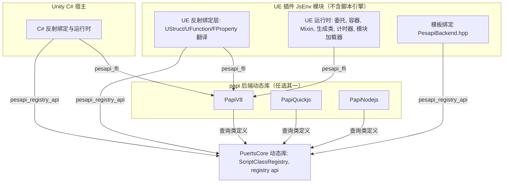
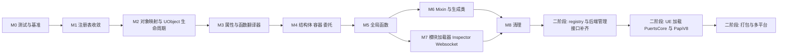

# Unreal 与 Unity 基于 papi 统一架构设计

状态：草案，待评审
范围：unreal/Puerts/Source/JsEnv、unity/native/puerts、unity/native/papi-*

## 1. 背景与目标

Unity 版 PuerTS 3.x 已经完成 papi 化：脚本引擎实现被封装为独立动态库（PapiV8、PapiQuickjs、PapiNodejs、PapiLua、PapiPython），宿主（C#）只通过 `pesapi_ffi` 函数指针表操作脚本值，通过 `pesapi_registry_api` 注册类型，类型注册表由独立的 PuertsCore 库承载。

Unreal 版目前仍是“V8 API 直接编程”的架构：JsEnv 模块把 V8 静态库链接进 UE 模块，反射绑定、容器、委托、Mixin、模块加载、调试器等全部直接调用 `v8::` API。前两次提交只完成了 pesapi 接口层（v11）与静态绑定的升级，UE 主体并未依赖 papi。

目标：

1. 第一阶段（papi 化）：UE 侧的绑定与运行时逻辑改为基于 papi 实现，papi 暂时缺失的能力允许继续调用 V8 API，但必须集中、可统计、可替换。
2. 第二阶段（统一二进制）：UE 与 Unity 加载同一份 papi 后端动态库（以及同一份 PuertsCore），UE 模块本身不再链接、不再 include 任何脚本引擎。

非目标：本文不涉及 TS 声明生成器、蓝图生成类的功能变化，不改变面向用户的 JS API。

## 2. 现状对比

| 维度 | Unity 3.x | Unreal 当前 |
| --- | --- | --- |
| 引擎接入 | PapiV8 等独立动态库，宿主只见 C ABI | V8 静态库链接进 JsEnv 模块 |
| 值操作 | `pesapi_ffi` 函数表 | 直接 `v8::Local<v8::Value>` |
| 类型注册 | PuertsCore 的 `ScriptClassRegistry`，可多实例，`set_registry` 绑定到 env | `JSClassRegister` 全局单例 |
| 宿主反射类型 | C# 类型经 registry 懒注册（on_class_not_found 加懒加载拦截器） | `FStructWrapper` 为每个 UStruct 直接生成 `v8::FunctionTemplate` |
| 对象映射 | papi-v8 内的 `CppObjectMapper`，ObjectCacheNode 缓存加生命周期回调 | `FJsEnvImpl::ObjectMap`、`FCppObjectMapper` 两套 |
| ESM、调试器 | 在 papi-v8 内部（BackendEnv、V8InspectorImpl） | 在 JsEnvImpl 内部 |
| 多后端 | 每个后端一个 papi 动态库 | 宏切换 V8 / Node / QuickJS（QuickJS 通过 v8 兼容层） |
| 已共享代码 | papi-v8 的 CMake 已直接引用 `unreal/.../V8InspectorImpl.cpp` 等文件 | 同左 |

UE 侧对 V8 的依赖规模（`v8::` 出现次数，按文件）：

| 文件 | 次数 | 行数 | 说明 |
| --- | --- | --- | --- |
| JsEnvImpl.cpp / .h | 906 / 307 | 4909 / 779 | 运行时主体：对象映射、全局函数、模块、Mixin、计时器、委托 |
| PropertyTranslator.cpp / .h | 374 / 71 | 1425 / 202 | FProperty 与 JS 值互转，热路径 |
| V8Backend.hpp | 326 | 677 | 模板绑定的 V8 后端 |
| ContainerWrapper.cpp / .h | 225 / 99 | 858 / 402 | TArray / TSet / TMap / FixedArray |
| StructWrapper.cpp / .h | 190 / 34 | 739 / 141 | UStruct 到 JS 类 |
| FFIBinding.cpp | 175 | 609 | libffi 绑定（可选功能） |
| CppObjectMapper.cpp / .h | 159 / 46 | 501 / 107 | 模板绑定对象映射 |
| UEDataBinding.hpp | 148 | 577 | UE 基础类型的模板绑定特化 |
| WebSocketImpl.cpp | 116 | 486 | 可选功能 |
| 其余约 30 个文件 | 约 700 | | 委托、函数翻译、DataTransfer、Inspector、Wasm3 等 |

合计约 4600 处，其中真正需要重写的业务逻辑集中在 JsEnvImpl、PropertyTranslator、FunctionTranslator、StructWrapper、ContainerWrapper、DelegateWrapper 六组文件。

## 3. 可行性结论

结论：两步都可行。第一阶段工作量大但风险可控；第二阶段的主要难点不在代码，而在二进制边界、打包与平台工具链。

支撑依据：

- 能力层面：Unity 用同一套 papi 承载了 C# 全量反射绑定（含继承、重载、属性、静态成员、委托、GC 宿主的生命周期跟踪），UE 的 UClass / UStruct / UFunction / FProperty 绑定在模型上与之同构，type_id 直接用 `UStruct*` 即可。
- 迁移层面：在 UE 自带的 V8 papi 实现里，`pesapi_value` 与 `v8::Local<v8::Value>`、`pesapi_env` 与 `v8::Local<v8::Context>` 只是 reinterpret 关系，可以逐函数、逐文件迁移，每一步都能编译、能运行，不需要一次性切换。
- 实现层面：papi-v8 的 `CppObjectMapper`、`BackendEnv`（ESM）、Inspector 已经在 Unity 侧跑通，UE 可直接复用，减少重复实现。
- 收益层面：第二阶段完成后，UE 自动获得 papi-quickjs、papi-nodejs 后端（替代现在的 QuickJS v8 兼容层和 Node 宏分支），V8 版本升级也与 UE 模块解耦。

主要风险（详见第 8 节）：热路径性能回退、JS 可见行为差异（原型链、属性枚举、对象身份）、UObject 显式销毁与地址复用、UE 静态初始化期注册、各平台打包。

## 4. 目标架构



二进制边界只允许三类 C ABI：

1. `pesapi_ffi`：值、作用域、引用、调用、对象映射。
2. `pesapi_registry_api`：类型注册与查询（含第二阶段需要补充的枚举接口）。
3. 后端管理接口：创建 / 销毁 env、GC、调试器、tick、终止执行等（第二阶段统一为一个函数表，见 6.3）。

## 5. 第一阶段：papi 化改造

### 5.1 原则

- 增量迁移：每个合入点都必须能通过 BuildPlugin 并通过回归测试，不做长期分叉分支。
- 行为不变：JS 可见行为（原型链、`instanceof`、属性可枚举性、对象身份、异常文本）以现状为准，差异必须在测试中显式记录。
- V8 逃生口集中化：暂时缺失的能力通过一个桥接头文件 `PapiV8Bridge.h` 访问 V8，禁止新代码在别处直接 include `v8.h`。桥接点的数量就是第二阶段的剩余工作量指标。
- 先换地基，再换上层：先统一 env 与注册表、对象映射，再迁移翻译器与运行时。

### 5.2 桥接层

```cpp
// PapiV8Bridge.h，仅第一阶段存在
namespace puerts::papi_bridge
{
inline v8::Local<v8::Value> ToV8(pesapi_value v);
inline pesapi_value ToPapi(v8::Local<v8::Value> v);
inline v8::Local<v8::Context> ToV8(pesapi_env env);
inline pesapi_env ToPapi(v8::Local<v8::Context> ctx);
inline v8::Isolate* IsolateOf(pesapi_env env);
}
```

- 这些函数只在 UE 自带的 V8 papi 实现下成立，依赖 v8impl 里的 reinterpret 约定，第二阶段整体删除。
- CI 增加一个检查：统计 `papi_bridge::` 和 `#include "v8.h"` 的出现位置，只允许减少不允许增加（白名单文件除外）。

### 5.3 环境与注册表

1. FJsEnvImpl 持有 `pesapi_env_ref` 与 `pesapi_ffi*`，所有新代码通过它们操作，旧代码通过桥接层取回 Isolate / Context。
2. 注册表向 Unity 的 `ScriptClassRegistry` 收敛：
   - 先让 `JSClassDefinition` 的字段布局与 `ScriptClassDefinition` 对齐（UETypeName、OnEnter / OnExit、Data 等字段 Unity 版已具备）。
   - 再把 `JSClassRegister` 的存储换成 `ScriptClassRegistry` 实例，对外保留 `RegisterJSClass` 等旧函数作为薄包装，保证已有用户代码与 DeclarationGenerator 不受影响。
   - UE 仍只用一个全局 registry，但通过 `set_registry` 绑定到每个 env，而不是在实现里写死。
3. UE 的对象映射向 papi-v8 的 `CppObjectMapper`（Unity 版，含懒加载拦截器）对齐，UE 的 `FCppObjectMapper` 退役。第一阶段在 UE 目录内维护一份对齐后的实现，不引用也不修改 `unity/` 下的源码（见 5.9）。

### 5.4 UE 反射绑定改造（核心）

现状是 `FStructWrapper` 为每个 UStruct 直接构造 `v8::FunctionTemplate`。改造后统一走 registry：

| UE 概念 | papi 映射 |
| --- | --- |
| UClass / UScriptStruct | `define_class(type_id = UStruct*, super_type_id = SuperStruct)`，在 `on_class_not_found` 中按需注册 |
| UFunction | `set_method_info`，callback 为通用 thunk，data 为 `FFunctionTranslator*` |
| 静态 UFunction | `set_method_info(is_static = 1)` |
| FProperty | `set_property_info`，getter / setter 为通用 thunk，data 为 `FPropertyTranslator*` |
| 构造 | constructor 回调创建 UObject 或分配 UStruct 内存 |
| 析构 | UStruct 由 finalize 释放；UObject 不释放，见 5.6 |
| 扩展方法（UEExtension） | 注册时合并进 method 列表 |
| TArray / TSet / TMap | 每类容器一个固定 type_id，native 对象为 `{容器指针, 元素 FProperty*, 是否持有}` 的包装 |
| 委托 | JS 函数存为 `pesapi_value_ref`，执行时 `call_function` |

翻译器接口改造：

```cpp
// 改造前
virtual v8::Local<v8::Value> UEToJs(v8::Isolate*, v8::Local<v8::Context>, const void* ValuePtr, bool PassByPointer) const = 0;
virtual bool JsToUE(v8::Isolate*, v8::Local<v8::Context>, const v8::Local<v8::Value>& Value, void* ValuePtr, bool DeepCopy) const = 0;

// 改造后
virtual pesapi_value UEToJs(pesapi_ffi* Apis, pesapi_env Env, const void* ValuePtr, bool PassByPointer) const = 0;
virtual bool JsToUE(pesapi_ffi* Apis, pesapi_env Env, pesapi_value Value, void* ValuePtr, bool DeepCopy) const = 0;
```

性能相关约束：

- 每次调用只 `get_env` 一次，Apis 与 Env 作为参数向下传递，避免重复取。
- 字符串优先 `get_value_string_utf16` 直接转 FString，避免 UTF8 中转。
- 基础类型属性（int / float / bool）在注册期选择专用 thunk，减少虚调用。
- 保留现有 `PUERTS_FORCE_CPP_UFUNCTION` 等开关的语义。

### 5.5 模块迁移清单

| 批次 | 内容 | 规模 | 依赖 |
| --- | --- | --- | --- |
| M0 | 回归测试与性能基准（见 5.8），桥接层，CI 计数检查 | S | 无 |
| M1 | 注册表收敛到 ScriptClassRegistry，模板绑定默认改用 PesapiBackend.hpp | M | M0 |
| M2 | 对象映射统一到 papi-v8 CppObjectMapper，UObject 生命周期方案落地 | M | M1 |
| M3 | PropertyTranslator、FunctionTranslator 改为 papi 签名 | L | M2 |
| M4 | StructWrapper 改为 registry 注册，ContainerWrapper、DelegateWrapper、Soft / Weak 包装 | L | M3 |
| M5 | JsEnvImpl 全局函数（puerts.*、UE 代理、计时器、日志、加载器回调）改为 `create_function` | M | M4 |
| M6 | Mixin、TS 生成类、蓝图调用 JS（InvokeJsMethod 等） | M | M5 |
| M7 | 模块加载器重做（见 5.10）：ESM / CJS 的编译、链接、求值全部在后端 C++ 实现，宿主只通过约定名的全局函数提供解析与读取；之后再做 Inspector、Promise 拒绝回调、env 入口作用域、Websocket 改用 wsppaddon | L | M5 |
| M8 | 收尾：V8Backend.hpp、V8Object.hpp、V8FastCall.hpp 保留为 V8 专属快速路径（不废弃，见 5.11）；FFI、Wasm3 改为基于 papi 的可选 addon 或保留 V8 专属 | S | M6 |

第一阶段完成判据：除 PesapiV8Impl、桥接层与白名单中的 V8 专属可选功能外，JsEnv 内不再 include `v8.h`。

M3 落地情况：

- `FPropertyTranslator` 的虚函数（UEToJs、JsToUE、JsToUEFast、UEOutToJs、JsToUEOut）已改为 papi 签名 `(pesapi_ffi* Apis, pesapi_env Env, ...)`。旧的 V8 签名保留为非虚的内联适配器，内部以 `v8impl::g_pesapi_ffi` 加 papi_bridge 转调，尚未迁移的调用方不用改，且没有额外开销。
- 直接用 papi 实现的类型：整数、浮点、布尔、枚举、FString、FName、FText（非 `PUERTS_FTEXT_AS_OBJECT` 模式）、FFieldPath、out 参数包装（`{0: value}`）、DoNothing。
- 依赖 IObjectMapper / DataTransfer 的类型（UObject、Soft、Interface、Struct、ArrayBuffer、JsObject、容器、定长数组、委托）暂时保留 V8 实现（`UEToJsV8` / `JsToUEV8`），papi 入口通过桥接转发，M4 随这些包装一起迁移。
- 抛异常仍走桥接调用 `FV8Utils::ThrowException`：`pesapi_throw_by_string` 需要 callback info，翻译器内部拿不到。
- 行为差异：
  - 数值转换失败（例如对象的 `valueOf` 抛异常）时，旧实现 `ToChecked` 会直接崩溃，现在按 pesapi 语义返回 0。
  - int64 / uint64 仍保持“不是 BigInt 就不修改原值”（先用 `is_int64` 判断）。
  - 字符串转换对非 string 值调用 `ToString`，无法转换的值（如 Symbol）得到空串，与旧 `ToFString` 一致；但 FName 旧实现走 `Utf8Value`，现在与 FString 一样。由于 pesapi 先取长度再写入，非 string 值的 `toString` 会被调用两次。
- 基准：property.*、ufunction.* 指标与 M1 结果相比正负交错，在噪声范围内（同轮未改动的 cpp.*、delegate、mixin 指标波动 10% 到 30%）。
- `FFunctionTranslator` / `FExtensionMethodTranslator`：调用路径（Call、FastCall、SlowCall、CallJs、CallExtension）已改为 papi 签名，参数读取用 `get_arg` / `is_undefined`，返回值用 `add_return`，异常用 `throw_by_string`，JS 回调用 `call_function`。V8 签名保留为内联适配器。
  - 调用目标 UObject 由 `get_native_holder_ptr` 取句柄后经 `DataTransfer::GetUObjectOfNativePtr` 解包，与 `GetUObjectOfWrapper` 行为一致。
  - 函数模板（`ToFunctionTemplate`）仍是 V8，M4 改为 registry 注册时一起迁移。
  - extension 方法的 receiver 值通过桥接 `HolderOf` 获取，因为 papi 目前只有 `get_native_holder_ptr`，没有取 holder 值的接口。
  - papi_bridge 增加了 `ToPapi(v8::Local<T>)` 模板重载：`v8::Local` 的转换构造函数不受约束，`Local<Object>` 等传给 `ToPapi` 时会在 value 与 env 两个重载间产生歧义。
  - 基准：ufunction.* 正负交错；delegate.cpp_to_js、mixin.cpp_to_js 两轮分别 +28%/+8%、+20%/+6%，落在 M2-1、M3-1 的历史区间内，判定为噪声。

M4 落地情况（分批进行）：

- M4-1：属性访问器与 UFunction 的回调改为 pesapi 风格（`void(pesapi_ffi*, pesapi_callback_info)`），翻译器通过 `get_userdata` 取得。`FPropertyTranslator` 持有 `JSPropertyInfo AccessorInfo`，`FFunctionTranslator` 持有 `JSFunctionInfo CallbackInfo`，v8 模板统一由 `ClassThunks` 根据这两个条目生成，与 registry 中静态绑定类的处理方式一致，为后续改成 registry 注册做准备。
  - `AccessorInfo` 在构造时填充：`CreateOn` 会在原地址 placement new 重建翻译器，复用的模板仍指向同一地址，重建后依然有效。
  - 委托属性的 getter 仍通过桥接调用 `IObjectMapper::FindOrAddDelegate`（委托包装在 M4-4 迁移）；`LinkOuter` 仍走桥接（papi 没有取 holder 值的接口）。
  - 基准：property.get_int 两轮均约 +10%（53ns 到 59ns），来自每次访问额外的几次 ffi 间接调用（get_userdata、get_native_holder_ptr、add_return）；其余 property.*、ufunction.* 在噪声范围内。M4 完成后统一评估是否为基础类型属性提供专用 thunk（见 5.4 性能约束）。
- M4-2：`FStructWrapper` 的静态函数 `StaticClass`/`StaticStruct`、`Find`、`Load` 改为 pesapi 回调，条目为 `StaticClassInfo`、`FindInfo`、`LoadInfo`，在构造时填充，模板由 `ClassThunks::MethodTemplate` 生成。新增 `Private/PapiUtils.h`，集中放置 papi 侧通用 helper（FString 转换、`GetUObject` 解包、`FindOrAddUObject`），属性翻译器中的字符串 helper 也改为转调它。
  - `FindOrAddUObject` 暂时通过桥接调用 `IObjectMapper::FindOrAdd`，M4-5 对象映射 papi 化后去掉。
  - 构造函数 `New` 仍是 v8 实现（pesapi 没有 IsConstructCall），留到 M4-6 改由 registry 构建模板时处理。
  - 基准：这批改动不在热点路径上，两轮数据都在噪声范围内（property.get_string 一轮为 104ns，复测为 76ns）。
- M4-3：容器包装（`TArray`、`TSet`、`TMap`、定长数组）的方法改为 pesapi 回调。每个包装用一张静态的 `JSFunctionInfo` 表，经 `ClassThunks::MethodTemplate` 生成原型方法。槽位沿用原布局：field 0 是容器指针，用 `get_native_holder_ptr` 读取；field 1 是元素翻译器（Map 为 key 翻译器），占用 papi 的 type id 槽，用 `get_native_holder_typeid` 读取。
  - Map 的 value 翻译器在 field 2，papi 只暴露两个槽，暂时通过桥接读取。M4-5 对象映射 papi 化时，改为让 field 1 指向一个 key/value 翻译器对。
  - 构造函数 `New` 和弱回调 `OnGarbageCollected*` 仍是 v8 实现，前者在 M4-6 处理，后者在 M4-5 处理。`LinkOuter` 仍走桥接。
  - 参数个数错误、索引越界等报错文本与原实现一致。`TSet.IsValidIndex` 原来返回数字，现在仍返回数字。
  - 基准：两轮测试中 array.get、map.get 与 M4-2 持平，array.num 多 1 到 2ns，处于噪声范围内。
- M4-4：委托包装（单播 `Bind`/`IsBound`/`Unbind`/`Execute`，多播 `Add`/`Remove`/`Clear`/`Broadcast`）以及 `TSoftObjectPtr`/`TSoftClassPtr`、`TWeakObjectPtr` 包装的方法改为 pesapi 回调，同样用静态 `JSFunctionInfo` 表生成原型方法。参数检查改用 `is_function`、`is_object`、`is_string`，UObject 参数经 `PapiUtils::GetUObject` 解包并检查是否已释放。
  - `IObjectMapper` 的委托接口（`AddToDelegate`、`RemoveFromDelegate`、`ClearDelegate`、`ExecuteDelegate`）参数仍是 v8 类型，暂时通过桥接转换；JS 函数参数也经桥接取 `v8::Function`。M4-5 对象映射 papi 化时一并改掉，届时委托属性 getter 也去掉桥接。
  - Soft 包装的 MetaClass 在 field 2，与 Map 的 value 翻译器一样暂时通过桥接读取。
  - 构造函数 `New` 仍是 v8 实现，留到 M4-6。
  - 基准：这批改动不在热点路径上。delegate.cpp_to_js 走的是 C++ 调 JS 的代理路径，本批未改动，194ns 到 209ns 视为噪声；其余项与 M4-3 持平。
- M4-5：翻译器与包装对 `IObjectMapper` 的访问统一收口到 `PapiUtils`（`FindOrAddUObject`、`FindOrAddStruct`、`FindOrAddContainer`、`CreateArray`、`AddSoftObjectPtr`、`FindOrAddDelegate`、`NewDelegate`、委托的增删清空与执行、`Merge`、`ThrowException`），这些 helper 是插件内对象映射桥接的唯一位置。`PUERTS_PAPI_FORWARD_*` 宏及 `UEToJsV8` / `JsToUEV8` 全部删除，UObject、Soft、Interface、Struct、ArrayBuffer、容器、定长数组、委托的翻译器改为直接用 papi 实现；委托属性 getter 和委托包装也不再直接桥接。
  - 取 native 指针统一用 `get_native_object_ptr`（与 `FV8Utils::GetPointer` 语义一致）；ArrayBuffer 用 `is_binary`、`get_value_binary`、`create_binary` / `create_binary_by_value`；`PUERTS_FTEXT_AS_OBJECT` 模式改用 `native_object_to_value`。
  - 仍保留的桥接：`FJsObject`（本身持有 v8 句柄，M8 处理）、FName 区分纯 ArrayBuffer 与 view（papi 不区分）、`LinkOuter`、Map 与 Soft 的 field 2。
  - `IObjectMapper` 接口本身仍是 v8 签名，随 M5 的 `FJsEnvImpl` 一起改为 papi，届时只需改 `PapiUtils`。
  - 范围调整：原计划放在 M4-5 的容器弱回调迁移和“Map 的 field 1 指向 key/value 翻译器对”移到 M4-6。pesapi 的 `set_ref_weak` 不带回调，弱回调只能通过 registry 类的 finalize 表达；而容器改由 registry 注册后，field 1 是固定的类 type id，翻译器需要放进 native 包装对象（见 5.4 中 `{容器指针, 元素 FProperty*, 是否持有}`），两项都依赖 M4-6。
  - 基准：两轮测试中 property.get_struct 为 79ns / 64ns，array.get 为 72ns / 59ns，ufunction.return_struct 为 627ns / 829ns，正负交错，判定为噪声；其余项与 M4-4 持平。
- M4-6（延后到 M6 之后）：UClass / UScriptStruct 的模板收进 registry。内容包括：在已有的 `on_class_not_found` 回调中按 UStruct 生成类定义；构造函数改为 papi（需要 `get_this`，见 5.7）；命名属性拦截、类名、热重载重新注册通过 UE 专用的 `CppObjectMapper` 钩子实现；UObject、Struct、容器的对象缓存从 `FJsEnvImpl` 迁到 `CppObjectMapper`，弱回调改用 finalize；容器的翻译器放进 native 包装对象。
  - 延后原因：这些改动依赖 `FJsEnvImpl` 的对象映射，等 M5、M6 把 `FJsEnvImpl` 的大部分改为 papi 后再做，改动面更小。M5 不依赖 M4-6。
  - `on_class_not_found` 的回调签名是 `int (*)(const void* type_id)`，不带 userdata，多个 env 共用一个 registry 时需要另行取得 env 上下文，届时再决定是否增加带 userdata 的变体。
- M4-6a：补反射绑定的功能测试（tests/reflection.js），固定生成类的 JS 可见形态：原型成员和描述符、类上的静态成员（`StaticClass` / `StaticStruct` / `Find` / `Load`）、类名（编辑器下为路径名）、构造参数（UObject 的 Outer / Name，结构体按属性顺序）、扩展方法、接口方法、FName 大小写修正。测试工程新增 `UPuertsTestReflectTarget`（实现 `UPuertsTestInterface`）和 `UPuertsTestExtension`。
  - 基线中记录了几处现有的特殊行为，迁移后需要保持或逐条评审：命名属性拦截器让 `hasOwnProperty` 对原型成员也返回 true；静态 UFunction 不随子类继承，子类构造函数的 `__proto__` 也不指向父类；大小写修正后的成员会以请求的名字缓存到原型上。
  - 修了一个上游既有问题：类构造函数和 `UE.NewObject` 的 Outer 传入非 UObject 值（如数字）时得到空 Outer，`NewObject` 直接 fatal。现在 null / undefined 退回 TransientPackage，其它值抛 "passing a invalid object"。
- M4-6b：`FStructWrapper`（含各类翻译器）改为进程级共享，为 `on_class_not_found` 不带 userdata 做准备。`FStructWrapper::FindOrAdd` 按 `GetFullName` 维护一张进程级表，模块卸载时 `ReleaseAll`；原来放在 wrapper 上的 env 状态移走：函数模板缓存改为每个 env 的 `CachedTemplates`（`PUERTS_REUSE_STRUCTWRAPPER_FUNCTIONTEMPLATE` 下按 wrapper 缓存），`IsNativeTakeJsRef`（mixin 只影响当前 env）和 `IsTypeScriptGeneratedClass` 改放在每个 env 的 `FTemplateInfo` 上。
  - 是否复用模板改为看当前 env 的缓存是否已有模板，而不是看进程表里是否已有 wrapper，因此第二个 env 首次使用某类型时仍会完整生成模板。
  - 非复用重建时只清 `ExternalInitialize`、`ExternalFinalize`、`Properties`，`GetPropertyTranslator` 命中已有翻译器时会把它补回 `Properties`，避免 struct 构造参数丢失；扩展方法加入时去重。
  - 已知遗留：同一 FullName 换了新的 UStruct*（如蓝图重编译生成新类）时仍沿用原有行为，M4-6e 新增类定义失效 API，默认仍保持该行为（见 M4-6e）。
  - 测试：两条路径 14 个用例全过（其中 5 个带 warning，都是用例有意触发的日志）。基准：与同时段 HEAD 对照持平（new.uobject 1614ns / 1751ns，tsclass.new 2190ns / 2239ns），之前基线的偏差是机器状态漂移。
- M4-6c：UClass / UScriptStruct 的模板改由 `CppObjectMapper::GetTemplateOfClass` 按类定义生成，删除 `FStructWrapper::ToFunctionTemplate`、`InitTemplateProperties`、`FFunctionTranslator::ToFunctionTemplate`、`FPropertyTranslator::SetAccessor`、每个 env 的 `CachedTemplates` 和 `PUERTS_REUSE_STRUCTWRAPPER_FUNCTIONTEMPLATE`。
  - 类定义：`FStructWrapper::GetClassDefinition` 生成 `FReflectedClass`（持有 `JSClassDefinition` 及其方法、属性数组和名字），`TypeId` 是 wrapper 本身，`SuperTypeId` 是父类的 wrapper（构建时先递归构建父类），`Data` 是 wrapper，`Initialize` 是 `ReflectedConstruct`：取出 wrapper 后按类型调用原有的 `FClassWrapper::New` / `FScriptStructWrapper::New` 完成创建和绑定，返回 nullptr 让 `CDataNew` 不再绑定。条目直接复用翻译器上的 `CallbackInfo` / `AccessorInfo`（复制后填名字），成员顺序和过滤规则与原 `ToFunctionTemplate` 一致。
  - 查找：registry 的 `FindClassByID` 在注册表找不到时回退到进程级的反射类表（wrapper -> 当前一代定义），因此 `Inherit` 走 `LoadClassByID` 即可找到父类。原设计中“在 `on_class_not_found` 里按 UStruct 生成定义”改为由 UE 侧显式构建，原因是无法安全判断任意 `type_id` 是否为 `UStruct*`；随之 `LoadClassByID` 只能找到已经构建过的 UE 类型定义。
  - 身份：模板按 `TypeId` 缓存在每个 env 的 `CppObjectMapper` 中，wrapper 按 FullName 保留，所以同一 FullName 换了新的 UStruct* 时生成新一代定义（只用于还没创建过该类模板的 env），已经创建过的 env 继续使用原来的 JS 类，只刷新翻译器，等价于原来的模板复用语义。旧一代定义仍被已有模板引用，随 wrapper 一起保留，有少量内存累积（M4-6e 改为由用到它的 env 持有，已解决）。另一个 env 首次使用已有定义的类型时只刷新翻译器，不重建定义。
  - UE 专用钩子 `FCppObjectMapper::OnTemplateCreated`：对 `Initialize == ReflectedConstruct` 的模板设置类名（`ScriptName`，编辑器下为路径名）并挂 FName 大小写修正的命名属性拦截器（代码原样搬自旧实现，M4-6d 已改为 Proxy，钩子现在只设置类名）。`CppObjectMapper` 生成模板时属性名、方法名统一改为 internalized 字符串。
  - 扩展方法表从每个 env 的 `ExtensionMethodsMap` 移到进程级（`FStructWrapper::InitExtensionMethodsMap`），构建定义时取用后删除；`FJsEnvImpl::InitExtensionMethodsMap` 转调它。
  - 行为变化：UFunction 方法、静态函数和 `StaticClass` / `Find` / `Load` 由 `ConstructorBehavior::kAllow` 变为 `kThrow`，这些函数不再带 `prototype` 属性，也不能被 `new`；扩展静态绑定（`FindClassByType`）的 `Initialize` 拿到的 userdata 现在是 wrapper（原来不是其类定义的 `Data`）；原型上访问器和方法的定义顺序变为“属性在前、方法在后”（`Object.getOwnPropertyNames` 的顺序变化，基线按排序比较不受影响）。
  - 测试：两条路径 14 个用例全过，Reflection 基线无差异；BuildPlugin 通过。基准：两轮 new.struct 为 283ns / 276ns（M4-6b 为 251ns / 264ns），多出的是 `CDataNew` -> `ReflectedConstruct` 的一次跳转，约 5%~10%；其余项与 M4-6b 持平（new.uobject 1688ns / 1547ns，tsclass.new 2067ns）。
- M4-6d：FName 大小写修正从实例模板上的命名属性拦截器（`kNonMasking`，只有 v8 能表达）改为 JS Proxy，`StructWrapper.cpp` 中搬过来的拦截器代码删除。
  - 结构：每个 env 一个 Proxy（`new Proxy({}, {get, set})`，target 是空对象，所以 Proxy 的原型仍是 `Object.prototype`，`instanceof Object` 和 `Object.prototype` 上的成员不受影响），在 `GetTemplateInfoOfType` 中对没有父类的反射类型（`UObject` 和每个没有 super 的 UScriptStruct）用 `Object.setPrototypeOf(fn.prototype, proxy)` 挂到原型链末端。工厂代码经 eval 得到（路径 `puerts/fname_fixing_proxy`），引擎相关的部分只有传给它的 `fixName` 回调。
  - 语义：只有成员在整条原型链上都找不到、且 key 不在 `Object.prototype` 上时才进入 trap。key 为非空字符串（长度小于 1024）时用 `fixName` 修正：取 FName 的 comparison entry（首次注册的大小写，与旧实现的 `FV8Utils::ToV8String(FName)` 一致；`FName::ToString` 走 display entry，会保留请求的大小写，不能用）。修正后的名字与原名不同且能在 receiver 的原型链上找到时，在拥有它的原型上用 `defineProperty` 以请求的名字缓存（访问器保留 get/set，数据属性保留 value/writable，都为 enumerable、configurable），然后转到修正后的名字读写；否则走 `Reflect.get` / `Reflect.set`，给实例新增的属性仍是实例自身的数据属性。QuickJS 下与原来一样不挂（冻结）。
  - 行为变化：`Object.prototype.hasOwnProperty.call(instance, '原型成员')` 由 true 变为 false（旧拦截器对原型成员也答“自有”）；没有父类的 struct 的 `Object.getPrototypeOf(S.prototype)` 不再是 `Object.prototype` 而是 Proxy（再往上才是 `Object.prototype`）。Reflection 补了 `instanceof Object`、`in`、`Object.prototype` 成员、实例新增属性、`then` 等观测。
  - 测试：两条路径 14 个用例全过，Functions、Reflection 基线只有上述两处预期变化；BuildPlugin 通过。基准与 M4-6c 持平，实例模板去掉拦截器后 property.struct_field 由 57ns 降到 47ns / 46ns，array.property_access 也略有下降；new.struct 两轮 283ns / 302ns，其余项在噪声范围内。
- M4-6e：新增类定义失效 API `pesapi_ffi.invalidate_class(env, type_id)`，追加在函数表末尾。
  - 语义：丢弃该 env 中 `type_id` 对应的脚本类缓存，下次使用时从 registry 重建；已有对象和已经拿到的旧类继续使用旧类（旧对象 `instanceof` 新类不成立）；不连带子类失效，已经生成的子类仍继承旧类。概念上对应 lua / python 中丢弃缓存的 metatable / 类型对象，与引擎和语言无关。v8 实现转给 `ICppObjectMapper::InvalidateClass`：`FCppObjectMapper` 从 `TypeIdToTemplateMap` 中删除该项；UE 的 `FJsEnvImpl` 还会删除 `TypeToTemplateInfoMap` 中该 wrapper 的项。papi_test 补了对应用例。
  - 版本：暂不提升 `PESAPI_VERSION`。插件入口名带版本号（`pesapi_register_<mod>_v<ver>`），提升会让已编译的插件全部失效，第一阶段新增的 API 都只追加不提升，到统一时一次性提升（待决策项 1 按此执行）。
  - 定义生命周期：`FStructWrapper` 只持有当前一代定义（`std::shared_ptr<FReflectedClass>`）。`CppObjectMapper::OnTemplateCreated` 改为 `std::function`，`FJsEnvImpl` 在钩子中把生成模板所用的定义存入本 env 的 `ClassesBuilt`，失效时移入 `RetiredClasses`；v8 的 FunctionTemplate 在 isolate 内不会被回收，两者都在 isolate Dispose 之后才释放。这样没有被任何 env 用过的旧一代定义在被替换时立即释放，M4-6c 的定义累积问题解决。
  - UE 策略：恢复宏 `PUERTS_REUSE_STRUCTWRAPPER_FUNCTIONTEMPLATE`（`StructWrapper.h`，默认 1，与上游一致）。为 1 时行为不变：同一 FullName 的新 UStruct 沿用原来的 JS 类，只刷新翻译器。为 0 时，`TryReleaseType` 之后再次使用该类型（本 env 的 `ClassesBuilt` 已有该 wrapper）会先 `invalidate_class` 再重建，新成员可见、`instanceof` 旧类不再成立。`GetTemplateInfoOfType` 改为先处理父类再生成本类模板，保证父类先失效、先重建。
  - 测试：默认配置两条路径 14 个用例全过；宏临时改为 0 再跑一遍也全过（TsClass、MakeUClass 经过 `TryReleaseType` 后的重建路径）；BuildPlugin 通过。基准与 M4-6d 持平（两轮取最小：new.uobject 1568ns，new.struct 293ns，tsclass.new 2004ns），array.property_access 的差异来自 M4-6d 第二轮的偏低值。
- M4-6f：struct、容器、Weak / Soft 包装的对象缓存和释放迁到 `CppObjectMapper`，弱回调全部改为类定义的 Finalize。先补测试（struct 与容器的对象身份、struct 生命周期，以及 Soft 的往返赋值和类型校验）。
  - struct：删除 `FJsEnvImpl::StructCache`，struct 对象经 `CppObjectMapper.BindCppObject` 用生成模板的那份类定义绑定，内存由 `JSClassDefinition::Finalize`（`FScriptStructWrapper::ReflectedFinalize`）释放。internal field 1 的 type id 改为 `FStructWrapper`（原为 UScriptStruct），`FStructWrapper::FromTypeId` 反查。POD struct 的 ArrayBuffer 优化分支保持不变（不缓存）。
  - 释放时机：GC 时，或 env 析构时在 `CppObjectMapper.UnInitialize` 中（isolate Dispose 之前）对仍存活的对象调用 Finalize，原来要等 isolate Dispose 后才能处理的 struct、容器内存现在都在 Dispose 之前释放。
  - `PointerHash` 修复：原来是恒等哈希，msvc 的 `std::unordered_map` 对对齐地址只落到少数桶里，改为混合地址位。
  - 容器：TArray / TSet / TMap / FixSizeArray 各有一个固定 type id 的进程级类定义（`FScriptArrayWrapper::GetClassDefinition` 等），经 `FindReflectedClass` 回退到 `FindContainerClass` 对所有 registry 可见。native 对象是 `FContainerHolder { 容器指针, type id, 元素和值的翻译器及 FProperty, 所在缓存, 是否持有 }`，即 5.4 中的 `{容器指针, 元素 FProperty*, 是否持有}`，Map 的 field 1 不再需要指向翻译器对。`FJsEnvImpl::ContainerHolders` 以容器指针为键保证对象身份（同一容器、同一元素类型返回同一 JS 对象），命中时用 `native_object_to_value(..., call_finalize = false)` 取缓存的 JS 对象；Finalize 先把 holder 从缓存中摘除，再按“是否持有”删除容器，最后释放 holder。删除容器的 v8 模板、`ContainerCache`、`BindContainer` / `UnBindContainer`。
  - `FPropertyTranslator::NativeValueOf`：取 JS 值对应的原生值，默认是 `get_native_object_ptr`，容器翻译器覆盖为检查 type id 后从 holder 取容器。`JsToUE`、FastCall（`JsToUEFast`）和 `$ref` 的回写都经过它，否则 FastCall 拿到的是 holder 而不是容器（`SumArray` 用例曾因此崩溃）。
  - Weak / Soft：`FWeakObjectPtrWrapper`、`FSoftObjectWrapper` 同样改为固定 type id 的进程级类定义，JS 对象由 `native_object_to_value(..., call_finalize = true)` 创建，native 对象在 Finalize 中释放。Soft 的 native 对象改为 `FSoftObjectHolder { FSoftObjectPtr, TWeakObjectPtr<UClass>, IsSoftClass }`，不再在 field 1 / 2 存原始 UClass 指针（原 Soft 的 field 2 桥接随之去掉）。`__tgjsMakeWeakObjectPtr` 改为 papi 函数，`IObjectMapper::AddSoftObjectPtr` 删除，翻译器直接调用 `FSoftObjectWrapper::Wrap`。
  - 行为变化：容器方法改由 registry 生成模板，`ConstructorBehavior` 跟随 `CppObjectMapper` 的默认值；`JsToUE` 和 FastCall 对 type id 不匹配的值不再当作容器（原来任何带 field 0 的包装都会被当作容器读取）；Soft 属性只接受 Soft 包装，传入 UObject 或普通对象时抛 "passing a invalid object for FSoftObjectPtr"（原来 UObject 的句柄会被误读成 `FSoftObjectPtr`）。
  - 测试：两条路径用例全过，Properties 基线只新增 Soft 的 4 条；BuildPlugin 通过。基准与 HEAD 背靠背对比（各两轮取最小，机器有漂移）：struct 一批 new.struct -15%、return_struct -8%；容器一批 array.* 持平，map.get -7% 到 -17%；cpp.overload、property.set_int 两次分别偏高 10% 到 25%，但这两条路径都没有改动，交替重跑 HEAD 后差距缩小，判定为代码布局或机器漂移。
  - 剩余：`IObjectMapper` 中 UObject 的 `Bind` / `FindOrAdd`、struct 的 `BindStruct` / `FindOrAddStruct`、`Merge`、`IsInstanceOf` 仍在桥接层转调 v8 实现（依赖 `ObjectMap` 的 v8 persistent 和 v8 模板），委托包装的模板和 `DelegateObjectInfo::JSObject` 仍是 v8，随后续批次处理。
- M4-6g：`IsInstanceOf`、`Merge`、struct 的创建和构造改为 papi。
  - `IsInstanceOf`：struct 用 `FStructWrapper::FromTypeId(get_native_object_typeid)` 判断后 `IsChildOf`，UObject 经 `PapiUtils::GetUObject`（排除 null 和 `RELEASED_UOBJECT`）。删除 v8 版本。
  - `Merge`（`ObjectMerger`）：papi 没有枚举自有属性的接口，用缓存的 `Object.keys`（`FJsEnvImpl::ObjectKeys`，自有、可枚举、不含 symbol，与原来 v8 默认的 `GetOwnPropertyNames` 一致）取 key，逐个 `get_property` 后按字段 `JsToUEInContainer`；值为普通对象且字段是 UObject / struct 时递归合并，值为 undefined 时跳过。补测试：原型链上的属性、不可枚举属性不合并，undefined 不覆盖。
  - `FindOrAddStruct`：改为 `native_object_to_value(env, wrapper, ptr, !PassByPointer)`，借用的 struct 由 `CppObjectMapper` 缓存，持有的由类定义的 Finalize 释放；持有的 struct 不再查缓存（原来会先查一次）。`IObjectMapper::BindStruct` 删除。
  - 构造：`FScriptStructWrapper::New` 改为 papi，返回内存交给后端 `CDataNew` 绑定（与普通 C++ 类相同），`IsConstructCall` 的检查也由 `CDataNew` 负责。
  - POD 优化分支（ArrayBuffer 在 v8 工作线程 GC 时释放内存，只在 `HAS_ARRAYBUFFER_NEW_WITHOUT_STL || WITH_BACKING_STORE_AUTO_FREE` 时启用）是剩余的 v8 依赖，隔离为 `FJsEnvImpl::BindPodStruct`；构造时经 `IObjectMapper::TryBindOwnedStruct(Info, wrapper, ptr)` 由后端决定是否走这条路，只有 POD struct 才调用。编辑器构建中该宏为 0，临时强制为 1 编译并跑测试通过。
  - 后端优化（v8 后端内部，与引擎无关）：`CppObjectMapper::TypeIdToTemplateMap` 的条目同时记下生成模板的那份类定义（模板的回调本来就引用它），`FindOrAddCppObject` 对已生成模板的类只查一次表，不再走 `LoadClassByID`（UE 下反射类要先查 registry、再查 `ReflectedClassMap`）；`pesapi_native_object_to_value` 直接调 mapper，少一层转发。
  - 测试：两条路径用例全过。基准与 HEAD 交替对比：new.struct、return_struct、struct_param 持平；property.get_struct 由 52 到 55ns 变为约 58ns，差距来自 papi 调用中 `Context::GetIsolate` 的跨模块调用（直接查缓存的实验版本为 52ns），属于 v8 后端的通用开销，后续统一优化。
  - 剩余：UObject 的 `Bind` / `FindOrAdd`（依赖 `ObjectMap` 的 v8 persistent、v8 模板和 `FClassWrapper::New`），委托的 `FindOrAddDelegate` / `ExecuteDelegate` 和委托模板。
- M4-6h：UObject 的绑定、缓存和构造改为 papi。
  - 包装形态：UObject 的 JS 对象改为由 `FClassWrapper` 的类定义创建的 native object，native 指针是 `FUObjectBinding`（继承 `FUObjectHandle`，额外记录所属 env 和 JS 对象的 `FPapiValueRef`），internal field 1 的 type id 由 nullptr 改为 `FClassWrapper`（与 struct 一致，`FStructWrapper::FromTypeId` 可反查）。对象由 `CppObjectMapper` 以 owned 方式绑定，类定义的 Finalize（`FClassWrapper::ReflectedFinalize`）经 `FUObjectHandle::Finalize` 回调到 env 释放 binding。`FUObjectHandle` 新增 `Finalize` 函数指针，handle 的布局其余不变。
  - 引用强弱：`FUObjectBinding::JsObject` 默认是强引用（native 持有 JS，对应 `IsNativeTakeJsRef`），`SetJsTakeRef` 时 Retain UObject 并对 value ref 调 `set_ref_weak`，由 JS 持有 UObject。判定逻辑（含 `PUERTS_KEEP_UOBJECT_REFERENCE` 的两种取值）不变。
  - 生命周期：UObject 先销毁时（`NotifyUObjectDeleted` -> `UnBind`）从 `ObjectMap` 摘除、释放 retainer 和 value ref，handle 的 `Object` 置空后放入 `ReleasedObjectBindings`，JS 侧再访问报 invalid object；wrapper 被 GC 时由 Finalize 从 `ObjectMap` 或 `ReleasedObjectBindings` 中摘除并删除 binding。env 析构时 `CppObjectMapper.UnInitialize` 对存活的 wrapper 调 Finalize，之后只清理残留条目。原来的 v8 弱回调 `OnGarbageCollected`、`OnReleasedObjectBindingGarbageCollected` 删除。
  - 接口：`FJsEnvImpl` 的 v8 版 `Bind` ×2、`UnBind` ×2、`FindOrAdd` ×2 删除，统一为 `FindOrAdd(pesapi_env, UClass*, UObject*, SkipTypeScriptInitial)`、`SetJsTakeRef(pesapi_env, UObject*)`、`UnBind(UObject*)`；`IObjectMapper::Bind` 改为返回 handle 交给后端绑定，`IObjectMapper::UnBind(UClass*, UObject*)` 删除。`JsConstruct`、`TsConstruct`、`InvokeJsMethod`、`RebindObject`、编辑器下的 GeneratedObjects 重建、`UETypeToJsClass` 中的 enum 对象都改走 papi 版本。
  - 构造：`FClassWrapper::New` 改为 papi（Outer、Name、Flags 三个参数的校验和报错文案不变），与 struct 相同由 `ReflectedConstruct` 返回 handle、`CDataNew` 绑定。papi 没有取正在构造的 `this` 的接口，`New` 中仍经桥接 `ToV8(Info).This()` 取得 JS 对象，交给 `Bind` 记录到 value ref，属于剩余的 v8 依赖。
  - `MergeObject`：type id 变化后，原来“type id 为空即 UObject”的判断失效，改为先 `FromTypeId` 后 `Cast<UScriptStruct>` 判定 struct，否则经 `GetUObject` 判定 UObject（已释放时抛 invalid）。
  - 测试：两条路径用例全过。基准与 HEAD 交替跑三轮（取最小）：new.uobject 1536ns -> 1702ns（+11%），makeuclass.new 2017ns -> 2337ns、tsclass.new 2009ns -> 2391ns（+16% 到 +19%），其余项持平。额外插入一次 value ref 的创建和 `set_ref_weak` 的实验表明 value ref 本身约 70 到 100ns（`operator new`、context 和 value 两个 Global、tracker 的 weak_ptr 拷贝）；其余来自 `CppObjectMapper` 对象缓存的插入和删除（UObject 身份由 `ObjectMap` 保证，这一层缓存对 UObject 是冗余的）以及 Finalize 多出的跨模块调用。这两项都属于 v8 后端的通用开销，留到后续统一优化（value ref 改为内联存储或池化；为“身份由宿主维护”的类定义提供跳过对象缓存的选项）。
  - 剩余：委托的 `FindOrAddDelegate` / `ExecuteDelegate` 和委托模板；`FClassWrapper::New` 中取 `this` 的桥接。
- M4-6i：委托包装改为 papi。
  - `FDelegateWrapper`、`FMulticastDelegateWrapper` 的 v8 模板（`FJsEnvImpl::DelegateTemplate` / `MulticastDelegateTemplate`）删除，改为固定 type id 的进程级类定义，经 `FindReflectedClass` 对 registry 可见。native 对象就是 `FScriptDelegate` / `FMulticastScriptDelegate`，不归 JS 对象所有（类定义没有 Finalize），由 `native_object_to_value(..., call_finalize = false)` 创建；JS 对象由 `DelegateMap` 以强引用的 `FPapiValueRef` 持有（原为 v8 persistent），条目释放时一并释放，复制出来的单播委托仍在条目释放时删除。env 析构时这些 value ref 改在 `CppObjectMapper.UnInitialize` 之前释放。
  - `FindOrAddDelegate`、`ExecuteDelegate` 改为 papi，`IObjectMapper` 中的桥接转发删除；`ExecuteDelegate` 改用 `FFunctionTranslator` 的 papi 版 `Call`，并只查一次 `JsCallbackPrototypeMap`。
  - 行为变化：委托属性的 `JsToUE` 只接受委托包装（按 type id 判断），其他包装（UObject、struct 等）不再被当作 `FScriptDelegate` 读取，参数保持为空委托。补测试 `non-delegate wrapper argument`，Delegates 基线只新增这一条。`constructor.name` 仍为空串（非反射类不设置类名）。
  - 测试：两条路径用例全过。基准与 HEAD 对比持平（delegate.cpp_to_js 238ns / 250ns，其余差异在 10% 以内且出现在未改动的路径上）。
  - 剩余：`FClassWrapper::New` 中取 `this` 的桥接；M4-6 其余收尾（`IObjectMapper` 中仍以 v8 类型出现的接口）随 M6、M7 处理。

M5 落地情况（分批进行）：

- M5-1：新增 `PapiMethodBindingHelper`（把成员函数绑定为 papi 函数，`this` 作为 userdata，经 `create_function` 加 `set_property` 挂到对象上）和 `PapiBindFunction`（绑定静态函数），以及与 `CHECK_V8_ARGS` 文案一致的 `PAPI_CHECK_ARGS`。首批迁移无状态的全局函数：`__tgjsLog`、`dumpStatisticsLog`、`isQuickJS`、`__tgjsFNameToArrayBuffer`、`puerts.getFNameString`、`puerts.toCString`、`puerts.toCPtrArray`。
  - 仍走桥接的部分：`__tgjsFNameToArrayBuffer` 用 `FV8Utils::ToFName` 区分 FName 原始缓冲和字符串；`dumpStatisticsLog` 读 v8 堆统计，属于 v8 专属能力，留在桥接层。
  - `toCString`、`toCPtrArray` 先在临时缓冲区里组装结果，再用 `create_binary_by_value` 拷贝出去，比原来多一次拷贝。这两个函数不在热点路径上。
- M5-2a：新增计时器的功能测试 `tests/timers.js`（注册、错误参数、触发、清除、额外参数、回调的 this），先固定现有行为作为基线。测试 runner 在每个 step 前 tick 一次 core ticker，计时器才能在测试中触发。
- M5-2b：`setTimeout`、`clearTimeout`、`setInterval`、`clearInterval` 改为 papi 实现。回调用 `pesapi_value_ref` 持有，触发时经 `get_ref_associated_env` 加 `open_scope_placement` 建立作用域，`call_function` 调用，异常用 `has_caught` 和 `get_exception_as_string` 取出并记日志。析构时在 `CppObjectMapper.UnInitialize` 之前释放这些 ref。
- M5-2c：`IObjectMapper` 改为 papi 签名（`pesapi_env`、`pesapi_value`、`pesapi_callback_info`），`PapiUtils` 的 helper 直接调用它，不再做 v8 转换。`FJsEnvImpl` 原来的 v8 版本方法去掉 virtual，作为内部实现保留，papi 版本的 override 在桥接层转调它们，后续逐个改成真正的 papi 实现。`ICppObjectMapper` 暂时保持 v8 签名，等 M6 处理。
- M5-2d：先补测试 `tests/objects.js`（`UE.NewObject`、`UE.NewStruct`、`puerts.merge`、`UE.MakeWeakObjectPtr`、`puerts.setJsTakeRef`），再把 `__tgjsMergeObject`、`__tgjsNewObject`、`__tgjsNewStruct`、`__tgjsSetJsTakeRef` 改为 papi 实现。`merge` 用 `get_native_object_typeid` 区分 struct（type id 即 UScriptStruct）和 UObject。
- M5-2e：`__tgjsUEClassToJSClass`（`blueprint.tojs`）和 `__tgjsNewContainer`（`UE.NewArray/NewSet/NewMap`）改为 papi 实现，测试先在 `tests/containers.js` 补齐。`UETypeToJsClass` 仍基于 v8 模板，经桥接调用，等 M4-6 收进 registry。补测试时发现 `UE.NewSet(-1)` 越界读 `BuiltinProperty[-1]` 导致编辑器挂死，已单独修复（下界检查）。
- M5-2f：先补测试（不同编码的脚本文件、加载失败、`puerts.loadUEType` 的各类参数），再把 `__tgjsSearchModule`、`__tgjsLoadModule`、`__tgjsFindModule`、`puerts.loadUEType` 改为 papi 实现。文件内容转字符串的逻辑（UTF-16 BOM、跳过 UTF-8 BOM）移到 `PapiUtils::FromFileContent`，字节码用 `create_binary_by_value`。`AddonRegisterFunc` 是对外的 v8 签名，`FindModule` 经桥接调用，保持兼容。
- M5-2g：`puerts.load`（`LoadPesapiDll`）和 `puerts.dll_ext` 改为 papi。`releaseManualReleaseDelegate` 依赖“JS 函数到 `UDynamicDelegateProxy`”的身份映射（v8::Map），且代理里持有 v8 函数，随 M6 的蓝图调用 JS 一起迁移；`MakeWeakObjectPtr` 依赖带内部字段和弱回调的模板，并入 M4-6。
- M5-2h：`Start()` 的主体（查找 `puerts.argv.add` 注入启动参数、调用 `require`）改为 papi，`require` 的异常经 `open_scope_placement` 的 scope 捕获并记日志。函数入口的 v8 Locker 和作用域属于 env 入口，随 M7 的 BackendEnv 一起替换。
- M5 收尾：其余仍为 v8 绑定的全局函数按归属延后，`__tgjsEvalScript`（含 ESM、字节码缓存、Inspector 用的 URL）和 `__tgjsSetInspectorCallback`、`__tgjsDispatchProtocolMessage`、`__tgjsSetPromiseRejectCallback` 归 M7；`__tgjsMakeUClass`、`__tgjsMixin`、`puerts.loadCPPType`（`ICppObjectMapper`）、`releaseManualReleaseDelegate` 归 M6；`__tgjsMakeWeakObjectPtr` 归 M4-6；Wasm3 归 M8。`IObjectMapper` 的 papi override 中依赖对象缓存和模板的（UObject、Struct、容器、Soft、`IsInstanceOf`）随 M4-6 改为真实现，委托相关的随 M6。
  - 行为变化：`setJsTakeRef` 传入非 UObject 时原来会空指针崩溃，现在抛出 "passing a invalid object"。
  - `MakeWeakObjectPtr` 依赖 v8 FunctionTemplate 和按 internal field 的弱回调，等 weak ptr wrapper 改为 registry 注册的类时一并迁移。
- M5 基准（每阶段取多轮最小值，M5 跑了 4 轮）：相对 M4-5，ufunction、property、容器、new、delegate、mixin 的指标在 -15% 到 +7% 之间，整体持平或略快；单轮看到的 return_struct、new.* 偏慢 15% 到 20%，多跑几轮后消失，属于噪声。M5 没有改动这些热路径，与预期一致。
- 已知退化：cpp.*（模板绑定的 C++ 类）自 M1-3c(2/2) 起比 baseline 慢约 4ns 到 8ns 每次调用（method_noop 14.3 到 18.5，method_int 18.1 到 24.7，static 13.4 到 18.1，overload 36.8 到 40.0）。M1-3a、M1-3b 与 baseline 持平，可以确认来源是模板绑定默认切到 `PesapiBackend.hpp`：每个参数和返回值都要经 `pesapi_ffi` 函数指针跨模块调用，无法内联，原来的 v8 后端是内联的 v8 调用。这是“共用同一个 papi 实现”的固有开销，Unity 走的也是这条路径。列为待优化项，可选方向：给高频的类型判断和取值做批量或快速路径接口（需新增 papi API，且必须与引擎和语言无关），或在静态链接时用直接调用代替函数表。在此之前不回退默认后端。
- M6-0：先补委托和 mixin 的测试（直接传函数的 manual release 代理、`[owner, fn]`、`[obj, "UFuncName"]`、按值返回和拷贝的委托、multicast 的重复添加和移除、owner 销毁后的委托；mixin 的错误参数、inherit、objectTakeByNative）。
  - 现有行为（未修改）：委托 a 拷贝给 b 后两者共享同一个代理，a.Unbind 经 `ClearDelegate` 重置代理的 JS 函数，之后执行 b 会触发 ensure "Invalid JS Function"。测试只观察 IsBound，不执行 b。
- M6-1：`UDynamicDelegateProxy` 的 JS 函数从 `v8::UniquePersistent<v8::Function>` 改为 `pesapi_value_ref`（加上所属的 `pesapi_ffi`），`InvokeDelegateCallback` 改为 papi 作用域（与计时器回调同一写法）。代理在 `BeginDestroy` 时释放 ref；env 析构时在 `CppObjectMapper.UnInitialize` 之前释放所有代理的 ref。
  - 基准（同机 A/B，各 2 轮取最小值）：delegate.cpp_to_js 191 到 222，每次回调多约 30ns（+16%），其他指标在噪声内。来源是 papi 作用域序列：约 7 次 ffi 间接调用、2 次 env 生命周期检查、3 次 context 的 Global 到 Local 转换，原来的 v8 写法是内联的。与 cpp.* 的退化同属 ffi 间接调用开销，一并列为待优化项（例如提供一次调用完成“按 value ref 打开作用域并取值”的接口）。
- M6-2a：`AddToDelegate`、`RemoveFromDelegate`、`ClearDelegate` 改为 papi 签名和实现；`DelegateObjectInfo::JsCallbacks`、`__removeListItem`、`__genListApply` 改为 `FPapiValueRef`（只能移动的 `pesapi_value_ref` 包装，析构时自动释放）。`DelegateObjectInfo::JSObject` 和委托对象的模板仍是 v8，等 M4-6。
  - 委托 JS 对象原来 internal field 0 上挂的 v8::Map 没有任何读取方，已删除。
  - 行为变化：`__genListApply` 抛出的异常原来被吞掉只打日志，现在会传给 JS 调用方（同时打 "gen callback apply fail"）。
- M6-2b：`NewDelegate`、`releaseManualReleaseDelegate` 改为 papi。manual release 代理原来用 v8::Map 把 JS 函数映射到 `v8::External`（代理指针），再用一个 vector 记录弱引用；papi 没有 external，改为 JS Map 把函数映射到 uint32 id，C++ 侧用 `TMap<uint32, TWeakObjectPtr<UDynamicDelegateProxy>>` 按 id 找代理。Map 用 `eval("new Map()")` 创建，`get`/`set`/`delete` 经 `call_function` 调用。释放时直接按 id 删除，不再遍历整个列表。
- M6-3：`__tgjsMixin` 和 `InvokeMixinMethod` 改为 papi，`MixinFunctionMap` 改为 `FPapiValueRef`，在 `CppObjectMapper.UnInitialize` 之前释放；`UJSGeneratedClass::Mixin` 去掉了没用到的 Isolate 参数。papi 没有枚举自有属性的接口，mixin 方法名改为经 `eval("Object.getOwnPropertyNames")` 加 `call_function` 获取（mixin 注册不是热路径，不缓存）。
  - 基准（同机 A/B，各 3 轮）：mixin.cpp_to_js 旧 350/319/410，新 390/390/434，取最小值 319 到 390，每次调用多约 40ns 到 70ns。来源与 M6-1 相同（papi 作用域序列），一并列入待优化项。
- M6-4a：补 makeUClass 功能测试（tests/make_uclass.js）。修了一个上游既有问题：`interceptClass` 给 `UE.xxx` 类挂的 proxy 截断了原型链，类上取不到 `hasOwnProperty`，`makeUClass` 对继承 `UE.xxx` 的类一直报错；改为用 `Object.prototype.hasOwnProperty.call`。
- M6-4b：`__tgjsMakeUClass`、`JsConstruct`、`InvokeJsMethod` 改为 papi。`UJSGeneratedClass` / `UJSWidgetGeneratedClass` 的 Constructor、Prototype 和 `UJSGeneratedFunction::JsFunction` 改为 `FPapiValueRef`，去掉了 THREAD_SAFE 下的 Isolate 成员和 StaticConstructor 里的 Locker（papi 作用域自带）。`IDynamicInvoker::JsConstruct` 改为接收 `pesapi_value_ref`，公共头 DynamicInvoker.h 不再包含 v8.h。papi 没有 set_prototype，用首次 makeUClass 时缓存的 `Object.setPrototypeOf`。env 析构时生成类的 Release 移到 `CppObjectMapper.UnInitialize` 之前。ObjectMap 中 binding 的 JsObject 仍是 v8，经 bridge 转换，等 M4-6。
  - 基准（同机 A/B，各 2 轮取最小值）：makeuclass.cpp_to_js 319 到 352（+33ns，+10%），来源同 M6-1；makeuclass.new 2054 到 2008，在噪声内。
- M6-5a：补 TS 生成类的功能测试和基准。测试工程不依赖 TS 编译和蓝图资源，`UPuertsTestTsTarget::CreateTsClass(Module)` 在 `/Game/Blueprints/TypeScript/<Module>` 包下用代码生成一个 `UTypeScriptGeneratedClass`（复制父类的 BlueprintEvent），JS 模块用 `exports.default` 导出继承 `UE.PuertsTestTsTarget` 的类；`RunScript` 增加 `bBindTsClasses` 参数，注册 UObject 创建监听器转发到 `FJsEnv::TryBindJs`，模拟 FPuertsModule 的行为。覆盖 CDO 和实例构造、`Constructor`、BlueprintImplementableEvent / BlueprintNativeEvent 的 C++ 和 JS 两侧调用、非 UFunction 方法、对象间字段隔离、覆写抛异常。
- M6-5b：TS 生成类改为 papi。`FBindInfo` 的 Constructor、Prototype 和 `TsFunctionInfo::JsFunction` 改为 `FPapiValueRef`；`MakeSureInject` 的注入逻辑抽到 `InjectTsClass`，在 papi 作用域里执行（require、取 default / prototype / Constructor、按 BlueprintEvent 收集覆写、链原型、`__mergePrototype`），异常统一记 "load module [%s] exception"；`TsConstruct`、`InvokeTsMethod`、`GetJsClass` 中的原型设置改为 papi。
  - papi 没有 set_prototype、get_prototype、has_own_property，新增 `GetCachedJsFunction`，按需 eval 并缓存 `Object.setPrototypeOf`、`Object.getPrototypeOf`、`Function.prototype.call.bind(Object.prototype.hasOwnProperty)`，makeUClass 也改用它。
  - `TsFunctionMap`、`BindInfoMap` 和上述缓存在 `CppObjectMapper.UnInitialize` 之前释放。父类没有 BindInfo 时不再用 `operator[]` 插入空项，改为退回原生原型。`InvokeTsMethod` 在 `FindOrAdd` 之前取出函数和 translator，避免注入导致 `TsFunctionMap` rehash 后访问悬空指针。
  - 入口的 v8 Locker / Isolate / Context 作用域保留，随 M7 替换；RebindObject 和对象首次绑定仍走 v8 版 `FindOrAdd(..., SkipTypeScriptInitial)`，等 M4-6。
  - 基准（同机 A/B，旧 1 轮、新 3 轮取最小值）：tsclass.cpp_to_js 349.5 到 381.3（+32ns，+9%），来源同 M6-1；tsclass.new 1932 到 1987，在噪声内。
- M6-6：`puerts.loadCPPType` 改为 papi，按名字在 registry 里找到类型后用 `pesapi_create_class(env, type_id)` 创建类，找不到时抛 "can not find type: xxx"（与原错误文本一致）。`FCppObjectMapper::LoadCppType` 的 v8 版本保留，papi_test 宿主还在用。
  - `ICppObjectMapper` 不改为 papi 签名。它是 papi-v8 后端的内部接口，使用方只有 PesapiV8Impl.cpp、DataTransfer.cpp（供 V8Object.hpp / JsObject.h 使用）和 papi_test 宿主，`FJsEnvImpl` 已经不再直接依赖它的 v8 签名。改签名没有收益，第二步换成共享的 papi dll 时随后端一起替换。

### 5.6 UObject 生命周期

UE 与 C# 的关键差异：UObject 可被显式销毁（Destroy、关卡卸载），且销毁后地址会被复用。如果直接把 `UObject*` 作为 papi 的 native 指针，papi-v8 的对象缓存（按指针加 type_id 查找）会在地址复用时返回过期的 JS 对象。

方案 A（推荐，无需新增 API）：句柄化，与 C# 的做法一致。

- native 指针不是 `UObject*`，而是 UE 侧分配的 `FUObjectHandle { TWeakObjectPtr<UObject> Obj; UClass* Class; }`，UE 侧维护 `UObject* -> FUObjectHandle*` 的映射。
- `trace_native_object_lifecycle` 的 on_enter 在 JS 包装对象创建时把 UObject 加入 GC 引用集合（对应 `PUERTS_KEEP_UOBJECT_REFERENCE`），on_exit 在 JS 对象被回收时移除并释放句柄。
- UObject 被销毁时只需把映射里的条目删除、句柄内的弱指针自然失效；JS 侧再访问会得到“对象已失效”的错误。句柄的地址在 JS 对象存活期间不会被复用，所以缓存不会命中过期对象。
- 代价是每次访问多一次解引用和弱指针校验，需要基准测试确认。

方案 B：新增 `pesapi_unbind_native_object(env, type_id, ptr)`，在 UObject 销毁时从缓存中摘除并清空 JS 对象内的指针。改动小、开销低，但需要 papi 增加 API，且 Unity 侧也要实现。

已决策：采用方案 A。方案 B 仅作为基准测试显示句柄开销不可接受时的备选。

M2 落地情况：

- 对象映射：UE 版 `FCppObjectMapper` 已与 Unity 版基本对齐（含 OnEnter / OnExit），差异只剩依赖 V8 >= 13 的 `PUERTS_LAZYLOAD`，暂不移植。M2 的主体是 UObject 句柄。
- 句柄定义见 `JsEnv/Public/UObjectHandle.h`：`FUObjectHandle { Magic; UObject* Object; FWeakObjectPtr WeakObject; UClass* Class; }`。`Object` 是原始指针，只作为映射的身份键，UObject 销毁后置空；`Magic` 用于拒绝把 struct、容器等非 UObject 包装传给 UObject 参数。
- UObject 包装的 internal field 0 存句柄（`FJsEnvImpl::FUObjectBinding`，在句柄上附带 JS 对象的 persistent），field 1 仍为 nullptr。`ObjectMap` 改为 `UObject* -> FUObjectBinding*`。
- UObject 先被销毁：条目移出 `ObjectMap`，句柄分离（Object 置空、弱指针 Reset），JS 对象改为以句柄为参数的弱引用并放入 `ReleasedObjectBindings`，待 JS 对象回收时释放句柄。JS 对象先被回收：直接释放句柄。
- 所有读取点统一走 `DataTransfer::GetUObjectOfWrapper` / `FV8Utils::GetUObject`，pending kill 语义不变（`Get()` 对 garbage 或 unreachable 返回空，UObjectBase 转换器与 `MakeWeakObjectPtr` 用 `Get(true)`，只排除 unreachable）。
- pesapi 侧不解包：方案 A 下 UObject 的 native ptr 本来就是句柄，`pesapi_get_native_object_ptr` 对 UObject 包装返回句柄，模板绑定中的 `void*` 转换器收到 UObject 时同样得到句柄。需要 `UObject*` 时应使用 UObject 类型的转换器。
- 基准：UObject 相关指标与 M1 结果相比在噪声范围内（同轮未改动的 cpp.* 指标整体波动约 10%），未启用方案 B。

### 5.7 papi 能力缺口

| 能力 | UE 现用途 | 第一阶段 | 第二阶段 |
| --- | --- | --- | --- |
| 回调中取 JS this 对象 | Mixin、TS 生成类、`super` 调用 | 桥接层取 V8 FunctionCallbackInfo | 新增 `get_this` |
| 抛出任意 JS 值 / Error 对象 | 保留异常类型与堆栈 | 桥接层 | 新增 `throw_value` |
| 弱引用被回收的回调 | 委托、Mixin 中 JS 函数的清理 | 桥接层或 `create_function` 的 finalize 间接实现 | 视情况新增 `set_ref_weak_with_callback` |
| UObject 失效 | 见 5.6 | 方案 A | 方案 A 或 B |
| 枚举对象自有属性 | JS 对象转 TMap、对象合并（Merge） | 桥接层 | 新增 `get_own_property_names`，或用 JS 辅助函数加 `call_function` |
| Promise 拒绝回调、微任务 | 未处理 Promise 报错、Tick 驱动 | 桥接层 | 后端管理接口 |
| ESM 模块、动态 import | `ExecuteModule` | 复用 papi-v8 BackendEnv | 后端内部实现 |
| Inspector、热重载 | 调试、`JsHotReload` | 桥接层 | 后端管理接口（热重载走 Inspector 协议） |
| 外部内存上报 | 大对象（容器、结构体）提示 GC | 桥接层 | 新增可选 API |
| Symbol、Proxy | `UE` 命名空间代理等 | 用 JS 辅助脚本实现 | 同左 |

新增 API 统一以“追加到函数表末尾”的方式进行，第一阶段不提升 `PESAPI_VERSION`（提升会改变插件入口名，见 M4-6e），统一时一次性提升。第一阶段只在 UE 自带的 PesapiV8Impl 中实现，不同步到 Unity；最终统一时再在 papi-v8、papi-quickjs、papi-nodejs 中补齐。

新增 API 必须与具体引擎、具体语言无关：papi 不只跨 JS 引擎（v8、quickjs），还跨脚本语言（目前有 js、lua、python）。判断标准是这个概念在 lua、python 里也能自然实现，比如 `get_this` 对应 lua 的 self、python 的 self，`get_own_property_names` 对应 table 的 key、dict 的 key。不满足的能力不进 `pesapi_ffi`，按以下方式处理：
- UE 宿主专属的（FName 属性名修正、类名、热重载重新注册等）：做成 UE 侧 `CppObjectMapper` 的钩子。
- JS 专属的（Promise 拒绝回调、微任务、ESM、Inspector、Symbol、Proxy 等）：放进后端管理接口，或用 JS 辅助脚本实现。
- v8 专属的（堆统计、external 等）：留在桥接层。

### 5.8 验证

- 扩展现有 `unreal/papi_test`（cmake + GitHub Action），覆盖新增 API 与桥接层约定。
- 新建 UE 自动化测试工程（Automation Spec），覆盖 UObject 绑定、容器、委托、Mixin、生成类、ESM、异常文本、对象身份、GC 后 finalize。迁移前先在现有实现上跑通，作为基线。
- 性能基准：UFunction 调用（0 参、3 参、字符串参数）、属性读写、容器遍历、结构体传值、模板绑定调用。每个批次合入前与基线对比，回退超过约定阈值（建议 10%）需说明或优化。

### 5.9 源码共享（延后）

papi-v8 的实现（PesapiV8Impl、CppObjectMapper、BackendEnv、DataTransfer）目前 Unity 与 UE 各一份，已经出现分叉。按决策，第一阶段由 UE 自己维护一份，不改动 `unity/` 目录；全部完成后再统一收敛为一份源码，届时再确定物理位置。

第二阶段开始后，UE 不再编译这部分源码，它只属于后端动态库。

### 5.10 M7：模块加载器重做

#### 5.10.1 现状问题

- Unity：`BackendJs.OnEnter` 先 `Eval` 一段 `esm_bootstrap.cjs`，由它在 global 上定义 `__puer_resolve_module_url__` / `__puer_resolve_module_content__`，C++ 再按名字取来用。启动依赖 Eval 源码。
- UE：ESM 的模块图在 `FJsEnvImpl`（`FetchESModuleTree` 等）里，直接用 `IJSModuleLoader`；CJS 在 `modular.js` 里把源码拼成 `(function (exports, require, module, __filename, __dirname) {...})` 再 `__tgjsEvalScript`；内置的 `puerts/*.js` 按经典脚本 `Script::Compile`。字节码的空源码由 JS 的 `generateEmptyCode` 生成；没有动态 `import()` 和 `import.meta`。
- 后续安全方向是发行版只支持字节码：会修改 v8 去掉源码编译，但保留接口，调用时抛异常；开发调试版仍保留源码加载。因此发行版下加载链路上不能有任何必经的源码编译（bootstrap Eval、CJS 源码拼接、JS 生成占位源码）。两边现有实现都依赖这些，无法满足。

#### 5.10.2 目标

- 模块的编译、链接、求值、缓存、动态 import、`import.meta` 全部在后端 C++ 实现，参考 d8 与 Node 的结构，不依赖任何 bootstrap JS。
- 输入既可以是源码也可以是字节码，由宿主按内容决定，后端不设“只允许字节码”的开关。源码路径照常调用 v8 的源码编译接口，发行版 v8 去掉源码编译后，这些接口抛出的异常原样透传给调用方。
- 只加载字节码时，整条链路（启动、内置脚本、CJS、ESM、互操作）不调用任何源码编译接口。
- 宿主契约与 JS 引擎无关：宿主是 .NET、Unity 或 UE，后端是 V8、QuickJS 或自研 VM，契约都一样；每个后端用自己引擎的模块 API 实现。
- 第一阶段只在 UE 落地，不改 `unity/`；跑稳定后再同步回 Unity，替换 `esm_bootstrap.cjs`。

#### 5.10.3 分工

宿主只负责“找”和“读”，其余都在后端：

| 职责 | 宿主 | 后端 C++ |
| --- | --- | --- |
| specifier 解析：相对路径、扩展名补全、目录 index、node_modules、package.json 的 type / main / exports | 是 | |
| 读取内容、决定是源码还是字节码、给出调试路径 | 是 | |
| 模块记录表、解析缓存、循环依赖、错误回滚 | | 是 |
| ESM 编译 / 链接 / 求值、顶层 await | | 是 |
| CJS 编译（函数包装）与 `require` 语义：缓存、循环依赖、`module.exports` | | 是 |
| ESM 与 CJS 互操作、JSON、内置模块 | | 是 |
| 动态 `import()`、`import.meta.url`、`import.meta.resolve` | | 是 |
| 字节码头校验、占位源码生成 | | 是 |

#### 5.10.4 宿主契约（约定名的全局函数）

宿主在 env 创建后、执行第一个模块前，用 `pesapi_create_function` 创建并设置到 global 上。后端首次用到时按名字取出，用 `v8::Global` 持有（QuickJS 后端用 JSValue 引用），随后从 global 上删除，避免业务脚本调用或篡改。

```js
// by: "import"（ESM 静态 / 动态 import）或 "require"（CJS require、宿主以 require 语义执行的入口）。
// 解析：返回规范化后的模块 url（同一模块必须返回同一字符串，后端以它作为缓存键）。
// 找不到返回 undefined，后端抛 "[Puer002] import xxx failed: module not found"；宿主抛异常则原样透传。
__puer_host_resolve__(specifier: string, referrerUrl: string /* 入口为 "" */, by: "import" | "require"): string | undefined

// 读取：按 url 读内容，同一 (by, url) 后端只调用一次。
__puer_host_load__(url: string, by: "import" | "require"): {
    kind: "esm" | "cjs" | "json",
    content: string | ArrayBuffer,  // ArrayBuffer 表示字节码
    debugPath?: string,             // Inspector / 异常栈使用的路径，不给则用 url
}
```

- 两个函数都是同步的。异步加载（比如 WebGL 下走网络）将来以可选的 `__puer_host_load_async__` 追加，不影响现有约定。
- `kind` 由宿主决定，后端不看扩展名，把 `.mjs` / `.cjs` / `.mbc` / `.cbc` / package.json type 这些规则留在宿主。UE 侧沿用现有规则：`.mjs`、`.mbc` 为 esm；`.cjs`、`.cbc` 为 cjs；`.js` 被 import 时为 esm、被 require 时为 cjs；`.json` 为 json。同一文件 `.js` 被 import 与被 require 是两条记录，因此 `by` 要传给两个函数；后端记录键为 kind 加 url。
- 内置模块（`puerts`、`ue` 等）不经过宿主，通过后端接口 `register_builtin_module(name, value)` 注册，解析时最先匹配。宿主也可以在 resolve 里懒注册（UE 的 addon 在首次用到时注册），再返回模块名，后端在 resolve 之后会再查一次内置模块。

#### 5.10.5 后端实现要点（papi-v8）

- 新文件 `PapiV8ModuleLoader.cpp/.h`，属于 UE 自己维护的 papi-v8 部分，后续随 5.9 一起收敛。`FJsEnvImpl` 里的 `FetchESModuleTree`、`FetchCJSModuleAsESModule`、`ResolveModuleCallback`、`GenEmptyCode`、`GetESMMain` 删除。
- 模块记录：`url -> { kind, v8::Global<Module 或 exports>, ResolveCache, debugPath }`，并用 `ScriptId` 反查 url，供 `ResolveModuleCallback`、`import.meta` 和动态 import 的 referrer 使用。
- ESM：`ScriptCompiler::CompileModule`；字节码走 `kConsumeCodeCache`，占位源码长度从字节码头读出，在 C++ 生成；`rejected` 时报 "invalid bytecode"。树加载失败时回滚本次新增的记录（Unity issue 1670 的处理）。
- CJS：`ScriptCompiler::CompileFunction`，参数为 `exports, require, module, __filename, __dirname`，取代源码拼接加 eval，同样支持 code cache。每个模块的 `require` 是 `create_function` 创建的 native 函数，referrer 放在函数数据里。保留 `puerts.forceReload`、`puerts.getModuleByUrl`、`puerts.registerBuildinModule` 的行为，`modular.js` 只剩薄壳或删除。
- 互操作：
  - ESM import CJS：SyntheticModule，`default` 为 `module.exports`，自有属性作为具名导出（与 UE 现状一致）。
  - CJS require ESM：同步求值后返回 namespace；遇到未完成的顶层 await 抛错（与 Node 22 的 require(esm) 一致）。
  - JSON：作为 `default` 导出的 SyntheticModule；CJS 中 require 直接返回解析结果。
- 动态 import：`SetHostImportModuleDynamicallyCallback`，在微任务里加载，结果用 Promise 返回；`SetHostInitializeImportMetaObjectCallback` 设置 `url` 和 `resolve`。
- 入口：后端给宿主一个 C 接口 `execute_module(env, specifier, referrer, out_exception) -> pesapi_value`（namespace 或 exports）。第一阶段放在 UE 侧 papi-v8 的头文件里，第二阶段并入 6.3 的 `pesapi_backend_api`。宿主的同步入口遇到顶层 await 时，跑微任务直到 Promise 结束；仍未结束（比如在等定时器）则返回明确错误，不再像现在这样死循环。
- JSON：不是 JS 源码，解析用 `v8::JSON::Parse`，发行版去掉源码编译后仍可用。

#### 5.10.6 UE 宿主侧

- `__puer_host_resolve__` / `__puer_host_load__` 基于现有 `IJSModuleLoader::Search` / `Load` 实现，package.json 的 type / main / exports 用 UE 的 Json 模块解析，替代 `getESMMain`。
- Windows 下调试路径的反斜杠转换（Inspector 断点匹配需要）放在宿主的 `debugPath` 里完成。
- 内置脚本 `puerts/*.js` 改为通过加载器按 cjs 加载，打包时可以和业务脚本一样产出字节码。
- `puerts.evalScript` / `__tgjsEvalScript` 等源码入口照常保留，供开发调试使用；发行版 v8 去掉源码编译后由 v8 抛异常。

#### 5.10.7 提交拆分

1. M7-1：加载器核心（ESM、CJS、JSON、内置模块、错误回滚）与 UE 宿主函数，先不接入，单独用新的功能测试 `tests/modules.js` 覆盖：相对与裸 specifier、循环依赖、ESM 与 CJS 互操作、JSON、加载失败后重试、顶层 await。
2. M7-2：`ExecuteModule`、全局 `require`、`puerts.*` 模块函数切到新加载器，删除旧实现；原有功能测试与基线保持一致。
3. M7-3：动态 `import()`、`import.meta`。
4. M7-4：字节码路径，测试工程增加字节码用例（离线生成 .mbc / .cbc），并验证纯字节码加载时整条链路不调用源码编译接口。
5. M7-5：M7-5a env 入口的 v8 作用域替换为 papi scope；M7-5b Promise 拒绝回调移到后端。
6. M7-6 及以后：原 M7 的 Inspector、Websocket 改用 wsppaddon。

#### 5.10.8 M7-1 落地记录

- 后端：`PapiV8ModuleLoader.h/.cpp`，`papi_v8::CreateModuleLoader / DestroyModuleLoader / ExecuteModule(env, specifier, referrer, byImport) / RegisterBuiltinModule / ForceReload / GetModuleByUrl / SetCodeCacheExpect`。加载器挂在 isolate 数据槽 2（0 为 mapper，1 为 PESAPI_PRIVATE）。`ExecuteModule` 失败返回 nullptr，异常留在 isolate 上由调用方处理。
- 记录与缓存：记录键为 kind 字符加 url；解析缓存键为 by、referrer、`\0`、specifier；加载缓存键为 by 加 url。记录被删除（失败回滚、forceReload）后缓存自然失效，下次重新走宿主。
- 回滚：嵌套加载用计数的 `FLoadScope`，失败时删除本次新增且未求值完成的 ESM 记录；CJS 执行失败删除该记录。加载失败后可以重试（Unity issue 1670）。
- 顶层 await：同步入口只跑一次微任务检查点，仍 pending 报 `[Puer004] top-level await of <url> can not be settled synchronously`，不再死循环。求值 Promise 被拒绝时挂一个空处理器再抛出，避免 promises.js 误报 unhandledRejection。
- 互操作与旧行为的差异：JSON 与内置模块被 import 时也把自有属性作为具名导出（与 CJS 一致）；合成模块的导出名在创建时确定。
- CJS 字节码：已有的 `.cbc` 是对整段包装源码 `(function (exports, require, module, __filename, __dirname) {...\n});` 用 Script 生成的 code cache，所以字节码仍走 Script 加 `kConsumeCodeCache`，执行后取到函数；源码走 `CompileFunction`（V8 11 以下 `CompileFunctionInContext`）。
- 字节码头的 FlagHash / ReadOnlySnapshotChecksum 目前沿用 `FJsEnvImpl` 编译空脚本取得的期望值（`SetCodeCacheExpect`），这一步本身是源码编译，M7-4 再解决。
- UE 宿主：`FJsEnvImpl::HostResolveModule / HostLoadModule`。require 时去掉开头的 `./`；找不到时 require 报 `can not find X in DIR`、import 报 `can not resolve [X], import by [file]`；package.json 用 UE Json 解析，esm 包被 require 时按 `exports["."]` 取 require 入口并强制按 esm 加载，cjs 包被 import 时按 require 规则加载；debugPath 以 `Pak: ` 开头时用 url，Windows 下转反斜杠；`OnSourceLoadedCallback` 在 load 时调用。
- 测试：临时全局入口 `__puerModuleLoaderTest`（不放在 `puerts` 上，避免影响 Modules 基线的 puerts keys），功能测试 `tests/module_loader.js`、数据 `tests/module_loader_data/`，基线 `Baseline/ModuleLoader.txt`。M7-2 接入后删除临时入口，用例改为直接 require / import。
- M7-2 待处理：`hot_reload.js` 对 CJS 用包装后的源码做 `setScriptSource`，改用 `CompileFunction` 后要去掉包装；内置 `puerts/*.js` 按 cjs 加载时检查对顶层 `var` / 全局变量的依赖；Node 下保留 `org_require` 优先。

#### 5.10.9 M7-2 落地记录

- 删除 `puerts/modular.js` 及 `FJsEnvImpl` 中的旧实现：`EvalScript`、`SearchModule`、`FindModule`、ESM 模块树（`FetchESModuleTree`、`ResolveModuleCallback`、`HashToModuleInfo` 等）、`Require` / `GetESMMain` / `GenEmptyCode`。原生 addon 在 `HostResolveModule` 中首次使用时注册为内置模块。
- 全局 `require` 为后端 `papi_v8::CreateRequire(env, "")`（新增，与 CJS 模块内的 require 相同，根目录相对）。`puerts` 上的模块函数：`genRequire(dir)`（dir 补 `/` 作为 referrer）、`registerBuildinModule`、`forceReload(url?)`（未加载时 warn `reload not loaded module`）、`getModuleByUrl`，url 开头的 `./` 忽略；`puerts` 本身注册为内置模块 `puerts`。
- puerts keys 去掉 `__require`、`generateEmptyCode`、`getESMMain`、`getModuleBySID`（Modules 基线已更新）。
- `FJsEnvImpl::ExecuteModule`：`.mjs` 交给后端按 ESM 执行；其余（启动脚本 `puerts/*.js`）仍按经典脚本执行，它们依赖顶层 `var global` 等全局声明。`Start`、`InjectTsClass` 改用 `RequireModule`（后端 require）。
- QuickJS（冻结）下没有模块系统：`RequireModule` 抛 `can not require [X], no module system`。
- Node：初始化时保存 Node 原来的全局 `require`（是函数时），require 一个非 `.`、`/` 开头的名字时先交给它，成功则把结果注册为同名内置模块；相对路径不再先试 Node（旧实现会试，但结果按名字全局缓存，有串用风险）。
- `hot_reload.js`：CJS 由 `CompileFunction` 编译，inspector 拿到的 scriptSource 是不带包装的原始源码，直接比较、`setScriptSource` 原始源码。
- 测试：`tests/module_loader.js` 改为直接用 require 与 `puerts.*`；ESM 用例在 M7-3（动态 import）前暂时也走 require。路径类报错变为 require 的文案（`can not find module_loader_data/X in <js-root>/tests`），非字符串参数报 `TypeError: the module name must be a string`。默认与 `v8_impl` 两条路径全部通过。

#### 5.10.10 M7-3 落地记录

- 动态 `import()`：`SetHostImportModuleDynamicallyCallback`（V8 10 及以上为 host_defined_options 加 resource_name 的签名，V8 9 用 WithImportAssertions 版本，更低版本用三参数版本）。回调里只创建 Promise，加载放到 `EnqueueMicrotask` 的微任务里执行（同 d8 / Node），按 import 语义 resolve（by 为 `import`），非 ESM 记录用合成模块，结果为模块命名空间；模块有顶层 await 时返回 `Evaluate` 的 Promise 链上命名空间，不再要求同步 settle。
- referrer：由脚本的 resource name（即 debugPath）经 `DebugPathToUrl`（ESM、CJS 记录创建时登记）反查 url；不是由加载器加载的脚本（启动脚本、eval）按根目录解析。
- `import.meta`：`SetHostInitializeImportMetaObjectCallback`，`url` 为宿主给出的 url（UE 下是文件路径，与 Unity 的 `puer:` 前缀不同），`resolve(specifier)` 只调用宿主 resolve（by 为 `import`）返回 url，不加载；内置模块返回其名字。
- Node 下加载器会覆盖 Node 自己设置的这两个回调，UE 脚本的 import 统一走加载器。
- 测试：第一步发起各类动态 import，下一步（中间跑定时器和微任务）检查结果，覆盖缓存共享、cjs / json / 内置模块、顶层 await（含定时器）、ESM 内的动态 import、`import.meta.url / resolve` 及错误；同步用例仍以 require 语义执行 ESM。

#### 5.10.11 M7-5a / M7-5b 落地记录

- M7-5a（env 入口）：新增 `FPapiEnvScope`（`PapiEnvScope.h`，只依赖 pesapi），在 env ref 上用 `open_scope_placement` 打开 scope（内存是成员，嵌套入口各用一块），env 已失效时不打开，用 `operator bool` 判断；提供 env、scope、`HasCaught`、`GetExceptionAsString`。`FJsEnvImpl` 长期持有 `MainEnvRef`（`CppObjectMapper.Initialize` 之后创建，`UnInitialize` 之前释放）。
  - 改为 `FPapiEnvScope` 的入口：`MakeSureInject`、`JsHotReload`、`ReloadSource`、`TsConstruct`、`InvokeTsMethod`（env 失效时 `SkipFunction`）、`NotifyReBind`（新增 `rebind exception` 日志）、`CheckDelegateProxies`、`RebindJs`、`Start`（去掉内层嵌套 scope）、`ExecuteModule`。原来的 v8 Locker、Isolate / HandleScope / Context scope 与 `v8::TryCatch` 都由 scope 承担；`ReloadModule` 去掉 Locker。
  - `ReloadJs`、`MergePrototype` 改为 `FPapiValueRef`，在 `UnInitialize` 之前释放；reload 调用统一为 `CallReloadJs`。启动脚本（经典脚本）改为 `pesapi eval`，`PapiUtils::EvalFileContent` 的编码判断与 `FromFileContent` 一致（UTF-16 BOM 转 UTF-8，跳过 UTF-8 BOM），Windows 下脚本名仍转反斜杠。
  - 保留为后端特定代码：只加锁、不碰 JS 的 `InitExtensionMethodsMap`、`NotifyUObjectDeleted`（热路径）、GC 通知，v8 专属的 `CurrentStackTrace`，构造与析构里 isolate 的创建销毁，Inspector、Wasm、Node 的 `UvRunOnce`；在调用方 scope 内取 `DefaultContext` 的 `invalidate_class`、`InstallFNameFixing`。
- M7-5b（Promise 拒绝）：后端 `PapiV8PromiseReject.h/.cpp`，`papi_v8::CreatePromiseRejectTracker(env, onHandlerError, userData) / DestroyPromiseRejectTracker / SetPromiseRejectHandler(env, handler)`，挂在 isolate 数据槽 3（最后一个槽）。回调参数为 `(event, promise, value)`，event 0 为未处理拒绝、1 为后加处理器（value 为 undefined）、2 / 3 为 settle 两次；处理器抛出的异常交给 `onHandlerError`（UE 下记 `promise reject handler exception`）。`__tgjsSetPromiseRejectCallback` 改为 papi 绑定，QuickJS（冻结）保留旧实现。
- 测试：新增 `tests/promises.js` 与 `Baseline/Promises.txt`（未处理拒绝的各类 reason、同步与微任务内处理、晚加 catch、settle 两次、off 后无监听的 warn、重新 on）。默认与 `v8_impl` 两条路径全部通过，BuildPlugin 通过，bench 与改动前持平。

#### 5.10.12 后端抽象（宿主与引擎解耦）

参考 Unity 的 `Backend` / `BackendJs` / `BackendV8` 与 `ScriptEnv`，宿主（`FJsEnvImpl`）不再直接引用 `v8impl::g_pesapi_ffi`，也不再负责 JS 特有的初始化：

- `IPapiBackend`（`PapiBackend.h`，与引擎、语言无关）：`GetApiVersion / GetApi / CreateEnvRef / DestroyEnvRef`，`OnEnter / OnExit`（语言运行时的启动与停止），`ExecuteModule / RegisterBuiltinModule`（宿主的 require、addon 与 Node 内置模块注册），GC 通知。宿主实现 `IPapiScriptHost::ExecuteModule`，供后端执行启动脚本。
- `FPapiBackendJs`（`PapiBackendJs.h/.cpp`，JS 语言层，与 JS 引擎无关）：`OnEnter` 中启动运行时，把 `puerts` 注册为内置模块，绑定 `require`、`puerts.genRequire / registerBuildinModule / forceReload / getModuleByUrl`、`__tgjsSetPromiseRejectCallback`，再按顺序执行 `puerts/first_run.js` 到 `puerts/pesaddon.js` 等启动脚本。对应 Unity `BackendJs.OnEnter`。
- `FPapiBackendV8`（`PapiBackendV8.h/.cpp`，V8 引擎层）：isolate / context 的创建与销毁（`--max-old-space-size`、NativesBlob），`CppObjectMapper.Initialize` 后创建 env ref，模块加载器、Promise 拒绝追踪、字节码头校验参数，GC。Node 下 isolate 与 context 由宿主创建（Node 环境要在其上建立），以 `ExternalIsolate / ExternalContext` 交给后端，后端不 Dispose。
- 宿主流程与 `ScriptEnv` 一致：`CreateEnvRef` → 校验 `GetApiVersion` → 宿主绑定（含 `__puer_host_resolve__ / __puer_host_load__`，Node 下先保存 Node 的 `require`）→ `OnEnter` → … → 释放宿主持有的引用 → `OnExit` → `DestroyEnvRef`。`DestroyEnvRef` 在 `UnInitialize` 之后、isolate Dispose 之前回调宿主的 `OnEnvReleased`（未找到类的绑定对象、Node 环境、Inspector、Mixin 还原），保持原有析构顺序。
- 选择后端只在构造函数一处；其余代码通过 `MainApis`（`Backend->GetApi()`）访问 papi。宿主中仍为 V8 专属的部分（Inspector、Wasm、`DelegateProxy`、`CurrentStackTrace` 等）继续通过 `MainIsolate` 使用，留待 M8 / 第二阶段。`PropertyTranslator.h`、`FunctionTranslator.h` 中基于 `g_pesapi_ffi` 的 v8 适配重载已无调用方，删除。
- 与 6.3 的关系：`IPapiBackend` 是第一阶段 UE 内的 C++ 形态，第二阶段后端在动态库中时，`FPapiBackendV8` 改为包装 `pesapi_backend_api` 的导出（与 Unity `BackendV8` 包装 `PapiV8Native` 相同），宿主与 `FPapiBackendJs` 不变。
- 测试：默认与 `v8_impl` 两条路径全部通过，BuildPlugin 通过。

#### 5.10.13 模块拆分（ScriptEnv / PapiV8 / JsEnv）

目标结构对应 Unity 的 core 与 V8 程序集，依赖方向是 V8 依赖通用层：

- `ScriptEnv`：通用宿主逻辑，`FJsEnvImpl` 改名 `FScriptEnv`（`FJsEnvGroup` 一并改为 Script 前缀），包含 `IPapiBackend`、`FPapiBackendJs`、注册表、翻译器、各类 wrapper 以及 UE 反射类型（`TypeScriptGeneratedClass`、`FJsObject` 等）。完成判据：Build.cs 不引用任何 V8 头文件路径与库，编译通过即证明不依赖 V8。
- `PapiV8`：依赖 `ScriptEnv`，包含 `PesapiV8Impl`、`CppObjectMapper`、`PapiBackendV8`、模块加载器、Promise 追踪、Inspector、V8 第三方库的链接与 V8 平台初始化，公开 `V8Backend.hpp / V8Object.hpp / V8FastCall.hpp / V8Utils.h / PapiV8Bridge.h`。
- `JsEnv`：兼容老业务的薄封装，Public 依赖前两者（老业务 include 不变），`FJsEnv` 内部以 `FPapiBackendV8` 构造 `FScriptEnv`。新业务直接用 `ScriptEnv`。日志类别 `LogJsEnv` 不改名。
- UE 反射类型包路径由 `/Script/JsEnv` 变为 `/Script/ScriptEnv`，用 `[CoreRedirects]` 的 `PackageRedirects` 兼容已有资产。
- 拆分后 QuickJS / Node 编译路径暂时断开，以后做 `PapiQuickJS` 等模块时恢复。

顺序：先在单一的 JsEnv 模块内把通用代码的 V8 依赖清干净（每步可测试），最后一次性拆模块，避免为过渡临时建 V8 External 模块、同一批文件搬两次。清理项：

1. 删除 FFI（libffi 绑定，默认关闭）与 Wasm3（`WasmCore` 模块、`PuertsWasm`、`wasm3_helper.js`、示例与文档）。两者都直接基于 V8 编写且很少使用，需要时再基于 papi 实现。（已完成）
2. `ICppObjectMapper` 的 V8 签名接口由宿主实现改为后端自己实现，宿主只通过 papi 化的 `IObjectMapper` 与钩子参与。（已完成）`FPapiBackendV8` 持有 `FCppObjectMapper` 并放进 isolate 槽 0；宿主的 `IObjectMapper` 在创建 env 后用 `set_env_private` 发布（槽 1，class 的 `OnEnter / Finalize` 拿到的 env private 也是它），`PapiUtils::ObjectMapperOf(Apis, Env)` 经 `get_env_private` 取回；`invalidate_class` 经 `FParams::OnClassInvalidated` 通知宿主清 UE 侧缓存。反射类模板（`GetTemplateOfClass / OnTemplateCreated`）暂经 `FPapiBackendV8::GetCppObjectMapper()` 访问，归第 4 步。
3. 参照 Unity `Backend.cs` 扩展 `IPapiBackend`：`OpenRemoteDebugger / DebuggerTick / CloseRemoteDebugger / LowMemoryNotification / OnTick`、堆统计、调用栈；Inspector 整体移入 V8 后端。（已完成）`IPapiBackend` 新增 `OpenRemoteDebugger(Port) / DebuggerTick / CloseRemoteDebugger / GetStatisticsLog / CurrentStackTrace`（均有默认实现）。`FPapiBackendV8` 持有 Inspector、Channel 与消息回调（`FPapiValueRef`），在 `StartRuntime` 中用 papi 函数绑定 `__tgjsSetInspectorCallback / __tgjsDispatchProtocolMessage`（早于 `hot_reload.js`），`StopRuntime` 释放回调，`DestroyEnvRef` 开头关闭 Inspector。宿主在 `CreateEnvRef` 之后、`OnEnter` 之前调用 `OpenRemoteDebugger(DebugPort)`（端口小于 0 不开远程服务，但热重载用的进程内会话仍可用），`WaitDebugger` 循环 `DebuggerTick`，`dumpStatisticsLog` 与 `CurrentStackTrace` 转调后端。UE 的 Inspector 自带 ticker，`OnTick` 暂不需要。测试新增热重载用例（经 Inspector 会话的 `Debugger.setScriptSource`）。
4. 宿主中剩余的 Isolate / Context / Locker / HandleScope、`InstallFNameFixing(FunctionTemplate)`、反射类模板的创建与命名、POD struct 随 ArrayBuffer 释放（改为后端钩子）等改走 papi。（已完成）反射类经 `create_class(env, FStructWrapper*)` 取类对象，取代 `GetTemplateOfClass`；类命名由后端 `FCppObjectMapper` 完成，`FParams::OnClassCreated` 改为返回 bool，宿主只对反射类返回 true（与旧行为一致，非反射类 `constructor.name` 为空），删除 `OnTemplateCreated` 与 `GetCppObjectMapper()`。`InstallFNameFixing` 改为对 `create_class` 返回的类取 `prototype` 后安装。POD struct 改走 `IPapiBackend::CreateTriviallyFreedObject / BindTriviallyFreedObject`，`WITH_BACKING_STORE_AUTO_FREE` 移入后端（宏不满足时返回空，宿主回退普通包装）；addon 改走 `LoadAddon`，`LoadCppType` 的注册表改走 `GetRegistry`；枚举 / 碰撞通道对象用 papi 构造。删除 QuickJS 的 promise reject 处理与 `MainIsolate / DefaultContext`，Node 路径改用独立的 `NodeIsolate` 成员。`DynamicDelegateProxy` 不再持有 Isolate，THREAD_SAFE 下由 `InvokeDelegateCallback` 等入口的 `FPapiEnvScope` 加锁。`IsReleasedPtr` 增加 `PapiUtils` 版本。
5. WebSocket 用 papi 重写，留在 `ScriptEnv`。（已完成）`WebSocketPP` 改为注册到 env 所用注册表的普通 C++ 类（构造 / 析构 / 方法都是 papi 回调），`InitWebsocketPPWrap(Apis, Env, Registry)` 用 `create_class` 取类挂到全局；JS 回调存为 `pesapi_value_ref`，只在 `poll` 内调用，`poll` 用嵌套的 papi scope 吞掉回调异常（与原 TryCatch 一致）。原先靠 V8 弱引用释放，现在走类的 finalize，env 销毁时也会释放。JS 侧 `websocketpp.js` 不变。测试新增 `tests/websocket.js`（无 baseline，`WITH_WEBSOCKET` 关闭时只检查未定义）：非法 URI、未连接时 send、拒绝连接触发 fail、回调异常不外抛、`statue`、非实例调用、GC 释放；开启 `WithWebsocket` 跑过一次全量测试。
6. `FJsObject` 改为持有 papi 值引用，`v8::Local` 构造函数移到 PapiV8 作为辅助函数。（已完成）`FJsObject` 只持有 `pesapi_ffi*` 与 `pesapi_value_ref`，env 经 `get_ref_associated_env` 取得（与 value ref 共用引用计数），`IsValid` 用 `env_ref_is_valid` 判断，取代原 `JsEnvLifeCycleTracker`。`Get / Set / Action / Func` 用 `FJsObjectScope`（`open_scope_placement`，THREAD_SAFE 下 scope 自带 Locker）进入 env，env 已释放时记 "JsEnv associated had release!" 并返回默认值；`Get` 遇到 undefined 返回默认值，调用异常记日志后返回默认值。THREAD_SAFE 下复制与释放引用时临时打开 scope 加锁。构造与翻译器只接受对象，非对象留空（属性赋非对象值时保留原值）。`pesapi_impl::Converter<FJsObject>` 不再限定插件模式；原 `v8::Local` 构造函数、`GetJsObject` 删除，改为 `JsObjectV8.h` 的 `MakeJsObject / JsObjectToV8` 与 `v8_impl::Converter<FJsObject>`（`PUERTS_BINDING_IS_PESAPI` 为 0 时由 `JsObject.h` 自动包含，拆模块时归 PapiV8）。测试新增 `tests/js_object.js`：参数 / 返回值 / 属性往返保持同一对象、Get / Set / Func / Action、异常日志、复制与自赋值、非对象值、模板绑定（两条绑定路径）、env 销毁后 C++ 继续持有时各接口安全返回。
7. 公开头文件拆分：`DataTransfer.h`、`V8Utils.h`、`PromiseRejectCallback.hpp` 归 PapiV8；`UEDataBinding.hpp` 的 pesapi Converter 改为不委托 `v8_impl`；`JSClassRegister.h`、`TypeInfo.hpp`、`JsEnv.h` 中零星 V8 类型改不透明指针或移走。（进行中）第一批（Private 部分）已完成：新增 papi API `get_this(info)`（回调的 this，构造回调中是正在构造的对象，对应 lua / python 的 self）与 `throw_error(env, msg)`（只有 env 时抛 Error，供翻译器、Converter 使用）。新增 v8 无关的公开头文件 `PapiDataTransfer.h`（`RELEASED_UOBJECT` 宏、`TScriptStructTraits`、`GetUObjectOfNativePtr`、FString 转换、`LinkOuter`（`WITH_OUTER_LINK` 下设置 0 号属性）、经 env private 的 `IObjectMapper` 实现的 `FindOrAddObject / FindOrAddStruct / IsInstanceOf`）与 `ArgType.h`，`DataTransfer.h` / `V8Utils.h` 改为包含它们。翻译器、wrapper 中的 `FV8Utils::IsReleasedPtr`、`HolderOf / This`、`LinkOuterImpl`、`PapiUtils::ThrowException` 改走 papi；`FName` 按值传递的判断改为 `is_binary` 且没有 `buffer` 属性（纯 ArrayBuffer）；`FNameToArrayBuffer` 改为字符串转换（原 `ToFName` 本来就只做字符串转换）；`PapiUtils::CheckArguments` 的 `EArgExternal` 恒不通过（papi 无 external，且无调用者）；`FExternalFinalizer` 改用 `GetPesapiFFI()`（第 8 步改由后端提供）。翻译器、wrapper、`JsEnvImpl.h`、`UEExtension.cpp` 不再包含 V8 头文件，`JsEnvImpl.cpp` 的 Node 代码与后端构造留到第 8 步。第二批已完成：`UEDataBinding.hpp` 不再包含 `DataTransfer.h`，改为包含 `PapiDataTransfer.h`；pesapi Converter（FString / FName / `const TCHAR*` / FText / FArrayBuffer / FArrayBufferValue / UObject、UObjectBase 指针 / UStruct 指针与值 / SelfChecker）改为纯 papi 实现，不再委托 `v8_impl`。原 `v8_impl` 部分移到新的公开头文件 `UEDataBindingV8.h`，只在 `PUERTS_BINDING_IS_PESAPI` 为 0 时由 `UEDataBinding.hpp` 末尾包含（拆模块时归 PapiV8）。`PesapiBackend.hpp` 在插件下不再包含 V8 头文件，`LinkOuter` 改走 `PapiDataTransfer::LinkOuter`。Unity 兼容：Unity 的 papi-v8 / papi-nodejs 直接编译或包含 `PromiseRejectCallback.hpp`、`V8InspectorImpl.*`、`WebSocketImpl.cpp`（`WITH_WEBSOCKET`）。因此 `PromiseRejectCallback.hpp` 在非 UE 下保留 `StackTraceToString`；`WebSocketImpl.cpp` 在 UE 下用 papi 实现，非 UE 下保留原 V8 实现与 `InitWebsocketPPWrap(v8::Local<v8::Context>)`。UE 判断与 `V8InspectorImpl.cpp` 一致（`UE_GAME / UE_EDITOR / UE_SERVER / USING_IN_UNREAL_ENGINE`）。拆模块时这几个文件要保持 Unity 能引用。
8. 拆模块、改名、CoreRedirects、其他模块依赖切换。

### 5.11 V8 专属快速路径（M8）

`V8Backend.hpp`、`V8Object.hpp`、`V8FastCall.hpp` 不废弃，作为“确定 JS 引擎是 V8 时”的可选快速路径保留：业务可以直接用 V8 API 写绑定，省去 papi 函数表的间接调用。

- 默认绑定仍是 `PesapiBackend.hpp`。V8 快速路径只在 V8 后端下可用，选用它的代码不能切换到 QuickJS 等后端，文档中写明。
- 第一阶段：保持现状可编译、可用，测试工程保留 `PUERTS_BINDING_IMPL=v8_impl` 这条测试路径。
- 第二阶段（共用动态库）的约束：
  - 后端动态库要导出 V8 符号，插件编译用的 V8 头文件必须与动态库内的 V8 版本和构建开关一致，版本校验纳入 6.5。
  - 快速路径里对象映射（查找、创建 JS 包装对象）改为经 papi 函数表完成（`pesapi_value` 与 `v8::Local` 互转零开销），不再跨库直接用 `ICppObjectMapper` 的 C++ 虚表，避免跨库 C++ ABI 依赖；值转换、函数调用这类热路径仍直接用 V8 API。

## 6. 第二阶段：UE 与 Unity 共用动态库

### 6.1 前提

- 第一阶段完成判据已满足：UE 模块不再 include 引擎头文件。
- 第一阶段暂留的 V8 专属能力已经转为 papi 新 API、后端管理接口，或者被标记为“仅 UE 自带 V8 模式可用”的可选功能。

### 6.2 注册表归属

- 由 PuertsCore 动态库承载唯一的 `ScriptClassRegistry` 实现；UE 只通过 `GetRegisterApi()` 得到的 `pesapi_registry_api` 操作，不再链接 C++ 符号。
- 需要补充的 registry API（主要服务于 DeclarationGenerator 与编辑器功能）：
  - 枚举已注册类。
  - 读取类定义（名称、父类、成员名、`class_type_info` 设置的反射信息指针）。
  - 按名称查找类。
- 反射信息（`CFunctionInfo` 等）由注册方用同一份 TypeInfo.hpp 生成，registry 只保存指针，并已有 `proto_magic_id` 做版本校验，不构成 ABI 问题。
- UE 的静态初始化期注册（`PUERTS_MODULE`、模板绑定的自动注册）可能早于动态库加载：UE 侧加一个注册队列，静态期只入队，JsEnv 模块启动并加载 PuertsCore 后统一提交。

### 6.3 后端管理接口统一

目前各后端导出的管理函数名不同（`CreateV8PapiEnvRef`、`CreateQjsPapiEnvRef`、`CreateNodejsPapiEnvRef` 等），且部分以 `v8::Isolate*` 为参数。建议新增统一入口，旧导出保留作兼容：

```c
struct pesapi_backend_api
{
    int version;
    const char* name;                       /* "v8" / "quickjs" / "nodejs" */
    struct pesapi_ffi* ffi;
    pesapi_env_ref (*create_env)(const struct pesapi_env_options* options);
    void (*destroy_env)(pesapi_env_ref env);
    void (*logic_tick)(pesapi_env_ref env);
    void (*low_memory_notification)(pesapi_env_ref env);
    int  (*idle_notification_deadline)(pesapi_env_ref env, double seconds);
    void (*request_full_gc_for_testing)(pesapi_env_ref env);
    void (*create_inspector)(pesapi_env_ref env, int32_t port);
    void (*destroy_inspector)(pesapi_env_ref env);
    int  (*inspector_tick)(pesapi_env_ref env);
    void (*terminate_execution)(pesapi_env_ref env);
    /* 后续追加：promise reject 回调、外部内存上报、热重载等 */
};

PESAPI_MODULE_EXPORT struct pesapi_backend_api* GetPapiBackendApi(void);
```

`pesapi_env_options` 至少包含：日志回调、模块加载回调（读取源码、解析路径）、调试端口、是否等待调试器、外部注入的线程或平台参数（预留）。

### 6.4 打包与平台

| 平台 | 形态 | 关注点 |
| --- | --- | --- |
| Win64 | PapiV8.dll、PuertsCore.dll | Unity 版使用 /MT，UE 使用 /MD；只要边界是 C ABI 且内存不跨库释放即可共存。UE 侧用 RuntimeDependencies 打包，延迟加载 |
| macOS | .dylib | rpath、签名、公证；Unity 已用导出符号白名单 |
| Linux | .so | 后端内部静态链接 libc++，符号用 version script 隐藏，不受 UE 自带 libc++ 影响 |
| Android | .so | 需要 UPL（APL xml）把 so 打进 apk；注意 16K page size（PuertsCore 已处理） |
| iOS | 静态库 | 不能 dlopen，UE 直接链接 .a；同一份源码与构建脚本产物，而非同一个文件。Unity 的 `-fembed-bitcode` 需要按 UE 的 Xcode 版本确认 |
| 主机平台 | 静态库 | 用各平台 SDK 构建，产物同源不同文件 |

“共用一个 dll”在桌面与 Android 上是字面意义的同一份二进制；在 iOS 和主机平台上是同一份源码、同一套构建脚本生成的静态库。

### 6.5 版本与兼容

- UE 启动时依次校验：`pesapi_backend_api.version`、`GetPapiVersion()` 与编译期 `PESAPI_VERSION`。不匹配时给出明确错误，不进入未定义行为。
- 函数表只追加不删改，旧 addon 按版本号走兼容路径。
- CI：用 `unreal/papi_test` 的思路增加一个“UE 宿主模拟器 + Unity 发布的 PapiV8 产物”的组合测试，保证同一产物两边都能跑。

### 6.6 第二阶段收益

- UE 用户可在 V8、QuickJS、Node.js 后端间切换，只需替换动态库；现有的 QuickJS v8 兼容层与 Node 宏分支可以下线。
- V8 升级只需重新构建后端动态库，UE 插件代码与 UE 版本无关。
- 修复与新特性在 Unity 与 UE 间天然同步，测试矩阵合并。

## 7. 实施顺序



## 8. 风险与对策

| 风险 | 影响 | 对策 |
| --- | --- | --- |
| 热路径性能回退 | UFunction 调用、属性访问是每帧开销 | 基准测试门禁；专用 thunk；Apis / Env 下传；必要时增加批量 API |
| JS 可见行为变化 | 用户 TS 代码依赖原型链、属性枚举、`toString` 等细节 | 迁移前建立行为基线测试；差异逐条评审 |
| UObject 地址复用 | 返回过期 JS 对象，难排查 | 5.6 方案 A 句柄化 |
| 静态初始化期注册 | 动态库未加载时注册丢失 | 6.2 的注册队列 |
| QuickJS / Node 后端在第一阶段无法同步迁移 | 桥接层依赖 V8 类型，QuickJS 兼容层下可能不成立 | 第一阶段冻结这两个后端（维持现状或暂停支持），第二阶段以 papi-quickjs / papi-nodejs 恢复 |
| 跨库 CRT 与 STL 差异 | 崩溃或内存损坏 | 边界只用 C ABI；谁分配谁释放；字符串返回值由被调方持有 |
| 第一阶段周期长导致分叉 | 合并冲突 | 增量合入主干；桥接层保证每步可编译 |
| FFI、Wasm3 等小众功能 | 迁移收益低 | 已删除（2026-10-26，见 5.10.13），需要时基于 papi 重新实现 |

## 9. 决策记录

已决策（2026-10-22）：

1. UObject 生命周期采用方案 A（句柄化）。
2. 第一阶段期间 QuickJS 与 Node.js 后端冻结、暂停支持，第二阶段以 papi-quickjs / papi-nodejs 恢复。
3. 第一阶段 UE 自己维护一份 papi 实现，新增的 papi API 也只在 UE 侧实现，不同步回 Unity。整个任务期间不改动 `unity/` 目录，全部完成后再统一（届时再处理 5.9 的源码收敛）。
4. 每个批次单独提交，批次内容多时拆成多个便于 review 的 commit；提交前在 WSL 下用 clang-format 12 格式化 `unreal/Puerts/Source`。

已决策（2026-10-23）：

1. M7 抛开 Unity 现有的 `esm_bootstrap.cjs` 方案，参考 d8 / Node 在后端 C++ 实现模块加载，宿主通过 `create_function` 注册约定名的全局函数提供读文件等能力，后端用 `v8::Global` 持有；目标是发行版只支持字节码（改 v8 去掉源码编译但保留接口、调用时抛异常），开发调试仍可加载源码，不设只允许字节码的开关。先在 UE 落地，稳定后再同步回 Unity。具体契约见 5.10（2026-10-23 已确认）。
2. M8 不清理 V8Backend.hpp、V8Object.hpp、V8FastCall.hpp，保留为 V8 专属快速路径（5.11）。
3. 5.10.4 的宿主契约（`__puer_host_resolve__` / `__puer_host_load__` 及返回结构）按文档执行；CJS 的编译与 require 语义（缓存、循环依赖、forceReload）一并迁入 C++，`modular.js` 只留薄壳或删除；内置 `puerts/*.js` 在打包时与业务脚本一样产出字节码。
4. M4-6 主体：FName 大小写修正改为在 `UE.Object.prototype` 等原型链末端挂 JS Proxy（只在成员找不到时进入，`hasOwnProperty` 对原型成员返回 true 的怪行为随之消失）；`FStructWrapper` 与翻译器改为进程级共享，`on_class_not_found` 不需要 userdata；蓝图重编译和热重载新增与引擎无关的“类定义失效”papi API，由 registry 和后端配合重建类。

已决策（2026-10-26）：

1. 模块拆分为 `ScriptEnv`（通用，完全不依赖 V8）、`PapiV8`（V8 实现）、`JsEnv`（兼容薄封装），具体见 5.10.13。`FJsEnv` 改名 `FScriptEnv`、`FJsEnvGroup` 一并改名，日志类别不改；反射类型包路径变化用 `PackageRedirects` 兼容；拆分后 QuickJS / Node 编译路径暂时断开。
2. 删除 FFI 与 Wasm3。

待决策：

1. 第 5.7 节新增 API 的命名（第一阶段只在 UE 侧，可边做边定）；`PESAPI_VERSION` 已定为第一阶段不提升、统一时一次性提升。
2. 性能回退阈值与基准测试运行环境（是否需要自托管 runner）。
